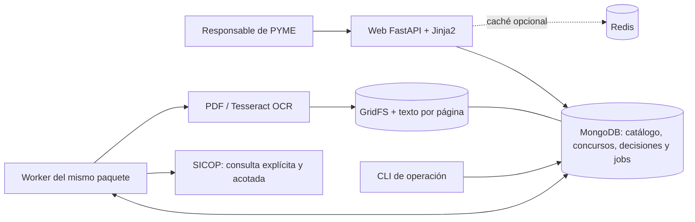
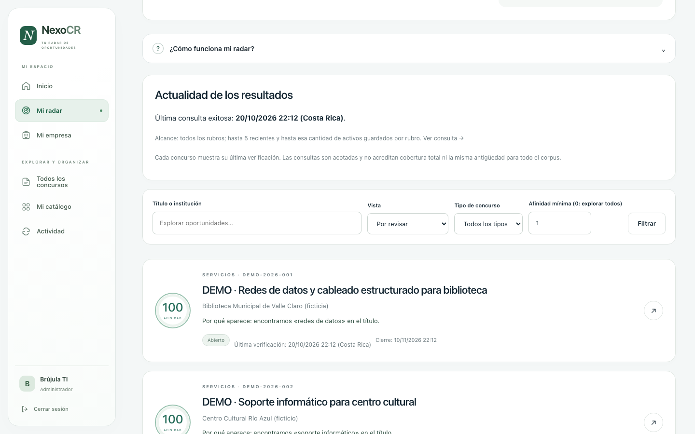
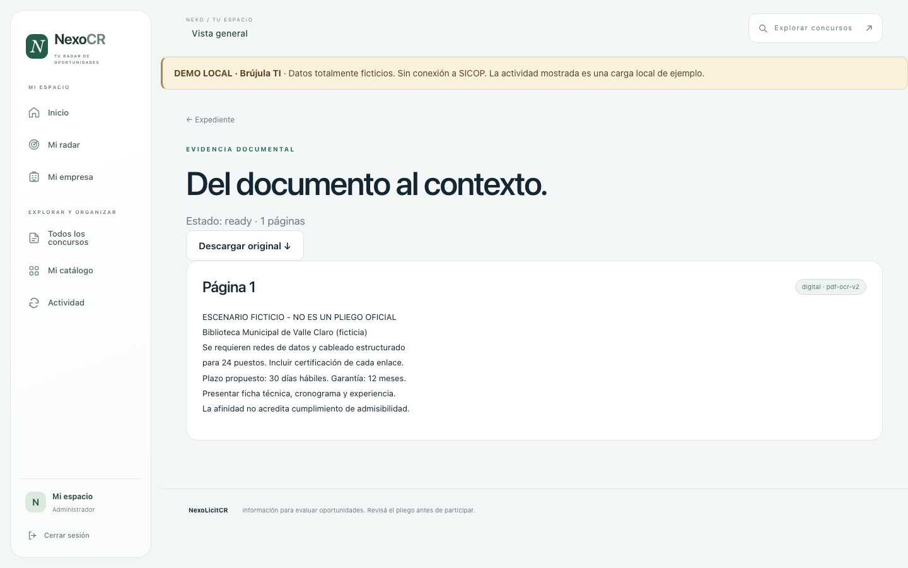

<p align="center">
  
</p>

<h1 align="center">NexoLicitCR</h1>
<p align="center"><strong>Automatizamos la búsqueda. Tu PYME construye el futuro.</strong></p>
<p align="center">Catálogo empresarial · Concursos SICOP · Evidencia documental · Seguimiento</p>

NexoLicitCR ayuda a las PYMES de Costa Rica a encontrar y revisar oportunidades de compra pública. Relaciona el perfil y catálogo de una empresa con concursos de SICOP, explica las coincidencias y conserva las decisiones de seguimiento. La afinidad orienta la revisión; la elegibilidad se verifica en el expediente original.

**Entrega:** [materiales de exposición](docs/entrega/README.md) · [cambios por versión](CHANGELOG.md) · [ficha del portal](portal.yml) · [documentación integral](docs/DOCUMENTACION.md).

## Contenido

- [Problema y usuarios](#problema-y-usuarios)
- [Capacidades y recorrido](#capacidades-y-recorrido)
- [Arquitectura y datos](#arquitectura-y-datos)
- [Instalación](#instalación)
- [Variables de entorno](#variables-de-entorno)
- [Datos de prueba y demostración](#datos-de-prueba-y-demostración)
- [Capturas](#capturas)
- [Validación y pruebas](#validación-y-pruebas)
- [Operación y solución de problemas](#operación-y-solución-de-problemas)
- [Roadmap](#roadmap)
- [Equipo y licencia](#equipo-y-licencia)

## Problema y usuarios

Una PYME debe revisar publicaciones, fechas, requisitos y anexos dispersos para decidir si un concurso merece atención. Repetir esa búsqueda consume tiempo y dificulta conservar el contexto de decisiones anteriores. NexoLicitCR reúne perfil empresarial, consulta acotada, evidencia y seguimiento en un mismo lugar.

| Persona | Necesidad y uso |
|---|---|
| Responsable comercial o propietario de una PYME | Describe sus capacidades, confirma servicios, revisa razones de afinidad y registra decisiones. |
| Administrador de la instalación | Crea la primera cuenta, configura la conexión a MongoDB y mantiene el proceso web y el worker. |
| Docente o evaluador | Reproduce una instalación y examina modelado documental, transacciones, GridFS, versiones y recuperación de trabajos. |

El producto implementa **una empresa, una base exclusiva y un único administrador por instalación**. El responsable comercial utiliza esa cuenta; no existen roles diferenciados, cuentas adicionales ni registro multiempresa. `INSTALLATION_ID` identifica una instalación, pero no habilita compartir su base entre empresas.

## Capacidades y recorrido

1. **Acceso:** registro de la primera cuenta, inicio/cierre de sesión, contraseñas con Argon2, sesiones persistentes y protección CSRF.
2. **Mi empresa y catálogo:** sector, varias especialidades, sugerencias revisables y servicios manuales con control de revisión para evitar sobrescrituras concurrentes.
3. **Consulta de SICOP:** alcance explícito por rubro y volumen, fechas observadas, reconsulta de activos y versiones cuando cambia el contenido.
4. **Actividad:** cola durable con progreso, reintentos, checkpoints, cancelación y reanudación de consultas interrumpidas.
5. **Radar y detalle:** razones por términos/códigos, fragmentos y páginas disponibles, filtros y advertencias de evidencia parcial.
6. **Documentos:** originales en GridFS, verificación de integridad y extracción de PDF/OCR español con límites de recursos.
7. **Seguimiento:** estados y notas que permanecen aunque se recalcule la afinidad o cambie el perfil.
8. **Histórico opcional:** ofertas presentadas por partida. Las adjudicaciones finales comparables requieren una fuente validada y siguen pendientes.

Las sugerencias de actividad y el matching usan reglas deterministas. La aplicación no incorpora un proveedor de IA generativa ni promete cobertura completa de SICOP. El [alcance académico](docs/alcance-academico.md) distingue lo obligatorio de las ampliaciones.

## Arquitectura y datos

Monolito Python: FastAPI sirve la API y las vistas Jinja2; la CLI y el worker usan el mismo paquete. La interfaz utiliza HTML, CSS y JavaScript nativo, sin npm ni servicios de fuentes externos.



| Área | Colecciones y criterio |
|---|---|
| Acceso | `users`, `sessions`, `login_tokens`, `login_limits`; hashes, vencimientos e índices TTL. |
| Empresa | `catalog`; perfil y servicios embebidos con revisión monotónica. |
| Concursos | `tenders` y `tender_versions`; identidad `cartelNo:cartelSeq`, snapshot actual e historial por hash. |
| Documentos | `documents`, `fs.files`, `fs.chunks`, `extracted_pages`; original, SHA-256, método de extracción y página. |
| Análisis | `matches` y `decisions`; resultados derivados separados de la decisión humana. |
| Operación | `jobs`, `sync_runs`, `metadata`; leases, checkpoints, historial y generación del corpus. |
| Histórico | `offers`; importes presentados, procedencia, partida y moneda. |

MongoDB es la fuente de verdad. La ingesta publica snapshot y versión en una transacción; requiere Atlas o un replica set autenticado. Un servidor MongoDB standalone no basta. Redis es opcional: sus fallos producen fallback y las claves incluyen instalación, base y versiones del catálogo/corpus. GridFS guarda los archivos antes de publicar su referencia; el comando `document-orphans` informa posibles huérfanos sin borrarlos.


Detalles: [arquitectura y dependencias](docs/architecture.md) · [modelo y decisiones técnicas](docs/guia/02-arquitectura-y-datos.md).

## Instalación

**Instalación guiada:** descargá y extraé el ZIP del repositorio. En Windows ejecutá `powershell -NoProfile -ExecutionPolicy Bypass -File .\install.ps1`; en Ubuntu/Debian o macOS, `bash install.sh`. Después usá `start.cmd` (Windows) o `bash start.sh`. [Requisitos y guía breve](docs/instalacion-sencilla.md).

### Requisitos

- Git y **Python 3.12 o 3.13**; el rango admitido es `>=3.12,<3.14`.
- [uv](https://docs.astral.sh/uv/getting-started/installation/) para instalar las versiones fijadas en `uv.lock`.
- MongoDB Atlas con usuario y acceso de red configurados, o MongoDB Community autenticado como replica set local.
- Para OCR nativo: Tesseract con idiomas `spa` y `osd`, y Poppler (`pdftoppm`) disponibles en `PATH`. Docker incluye estas dependencias.
- Navegador y acceso a SICOP para consultas reales. Los datos sintéticos se pueden preparar sin consultar SICOP.

Los comandos siguientes se ejecutan desde la raíz del repositorio. Los ejemplos usan una terminal Bash/zsh; en PowerShell, copiar archivos con `Copy-Item` y asignar variables temporales con `$env:NOMBRE="valor"`.

### Opción A: aplicación nativa con Atlas

**1. Obtener el proyecto e instalar dependencias.**

```bash
git clone https://github.com/EstebanS3/NexoLicitCR.git
cd NexoLicitCR
uv sync --frozen
cp .env.example .env
```

Copiar el ejemplo solo en una instalación nueva. Si `.env` ya existe, conservarlo y revisar las variables nuevas manualmente.

**2. Configurar Atlas.** En el archivo privado `.env`, completar `ATLAS_URI`, `ATLAS_USUARIO`, `ATLAS_CLAVE` y `ATLAS_BASE`. La URI tiene formato `mongodb+srv://cluster.example.mongodb.net/`, sin credenciales embebidas. Usar una base exclusiva y un usuario con permisos de lectura/escritura sobre ella; autorizar la IP saliente en Atlas. Mantener `MONGO_MODE=atlas`, `APP_MODE=local`, `PUBLIC_ORIGIN=http://localhost:8000` y `SICOP_TIMEZONE=America/Costa_Rica`. `REDIS_URL` vacío permite empezar sin Redis.

**3. Preparar índices e iniciar.**

```bash
uv run nexolicit init-db
uv run nexolicit api
```

Abrir **[http://localhost:8000](http://localhost:8000)**. En una base nueva aparece el registro: elegir usuario y contraseña de **14–256 caracteres**, iniciar sesión y configurar la empresa. El registro se cierra al existir la primera cuenta, incluso si luego se desactiva. No hay contraseña predeterminada ni recuperación desde ese formulario.

`api` en modo local inicia y supervisa también el worker. Ctrl+C detiene la aplicación y su worker. Para administración separada, ejecutar en terminales distintas `uv run nexolicit api --no-worker` y `uv run nexolicit worker`. La alternativa de alta por consola es `uv run nexolicit create-admin`, que solicita la contraseña de forma oculta y no reemplaza cuentas existentes.

**4. Verificar el arranque.**

```bash
curl http://localhost:8000/health/live
curl http://localhost:8000/health/ready
```

`live` confirma que el proceso responde; `ready` comprueba la conexión MongoDB seleccionada. La salud web no demuestra por sí sola que un trabajo haya sido procesado: verificar también Actividad.

### Opción B: Docker Desktop + Atlas

Requiere Docker Desktop activo con Compose. No instala un servidor MongoDB local; utiliza Atlas externo.

```bash
cp .env.atlas.example .env.atlas
```

Completar las credenciales y base en `.env.atlas` con el mismo criterio de la opción A. Después:

```bash
docker compose up --build -d --wait
docker compose ps --all
```

Abrir [http://localhost:8000](http://localhost:8000) y registrar la primera cuenta. `init-db` prepara índices antes de web y worker; su salida con código 0 es normal. `.env.atlas` es independiente de `.env`. Para detener los contenedores conservando la base Atlas: `docker compose down`.

Redis puede habilitarse configurando `REDIS_URL=redis://redis:6379/0` en `.env.atlas` y ejecutando `docker compose --profile cache up -d`. Para cambiar puerto y origen, importar una conexión existente o usar servidor público, consultar [operación Docker/Atlas](docs/operations.md#docker-desktop-con-atlas-externo).

### Opción C: MongoDB local autenticado

Instalar MongoDB Community y localizar el ejecutable `mongod`; Compass administra la base, pero no reemplaza el servidor. El helper está orientado a un entorno POSIX con soporte de `mongod --fork` (macOS/Linux). En una copia nueva **sin `.env`**, después de `uv sync --frozen`:

```bash
uv run python scripts/local_mongo.py start --mongod /ruta/al/binario/mongod
uv run nexolicit api
```

El helper crea `.env` privado con claves aleatorias, la base `nexolicit_local`, índices y un replica set `nexo-local` en `127.0.0.1:27017`. Conserva credenciales y datos en `var/mongodb/`, fuera de Git. No reemplaza configuraciones existentes; para un servidor ya administrado usar [.env.local.example](.env.local.example) como referencia. El usuario generado tiene acceso únicamente a `nexolicit_local` y `nexolicit_test_local`.

Para parar MongoDB sin borrar datos:

```bash
uv run python scripts/local_mongo.py stop
```

Un solo nodo permite demostrar transacciones, pero no alta disponibilidad. `MONGO_MODE=local` solo está permitido junto con `APP_MODE=local`, autenticación y conexión de loopback.

### OCR nativo

En macOS con Homebrew:

```bash
brew install tesseract tesseract-lang poppler
tesseract --list-langs
```

Verificar que la lista incluya `spa` y `osd`; reiniciar web y worker después de instalar. En otros sistemas instalar los paquetes equivalentes. Los límites predeterminados son 20 MiB por archivo, 5 anexos por concurso, 30 páginas y 120 segundos de extracción. Una extracción parcial se muestra como tal; no prueba ausencia de requisitos. [Detalles de OCR y plataformas](docs/operations.md#documentos).

## Variables de entorno

La configuración se lee desde el entorno y `.env`; Compose inyecta `.env.atlas` o el archivo indicado por `NEXO_ENV_FILE`. Los nombres y valores predeterminados siguientes corresponden a [Settings](src/nexolicitcr/config.py). Los ejemplos sanitizados están en [.env.example](.env.example), [.env.local.example](.env.local.example) y [.env.atlas.example](.env.atlas.example).

| Variable | Predeterminado | Uso |
|---|---|---|
| `MONGO_MODE` | `atlas` | Backend: `atlas` o `local`. |
| `ATLAS_URI` | Vacío | Obligatoria en Atlas; URI SRV sin usuario/clave. TLS obligatorio. |
| `ATLAS_USUARIO`, `ATLAS_CLAVE` | Vacíos | Credenciales separadas obligatorias en Atlas. |
| `ATLAS_BASE` | `nexolicit_dev` | Base exclusiva de la instalación. |
| `ATLAS_AUTHDB` | `admin` | Base de autenticación Atlas. |
| `MONGO_LOCAL_URI` | `mongodb://127.0.0.1:27017/?replicaSet=nexo-local` | Solo loopback, puerto explícito y replica set indicado. |
| `MONGO_LOCAL_USUARIO`, `MONGO_LOCAL_CLAVE` | Vacíos | Credenciales obligatorias en modo local. |
| `MONGO_LOCAL_BASE` | `nexolicit_local` | Base local; debe comenzar por `nexolicit_`. |
| `MONGO_TIMEOUT_MS` | `5000` | Tiempo de espera de MongoDB; ejemplo Docker: `15000`. |
| `APP_MODE` | `local` | `local` o `server`; servidor requiere origen HTTPS. |
| `PUBLIC_ORIGIN` | `http://localhost:8000` | Origen exacto del navegador, sin ruta ni credenciales. |
| `SICOP_TIMEZONE` | Vacío | Configurar `America/Costa_Rica`; vacío deja las fechas sin offset pendientes de interpretar. |
| `SICOP_REQUEST_DELAY_SECONDS` | `2` | Pausa mínima entre solicitudes a SICOP. |
| `INSTALLATION_ID` | `nexolicit` | Identificador único y estable para jobs y caché. |
| `ENVIRONMENT` | `development` | `development`, `test` o `production`. |
| `REDIS_URL` | Vacío | Vacío desactiva caché; admite `redis://` y `rediss://`. |
| `REDIS_NAMESPACE` | `nexolicitcr` | Prefijo de caché. |
| `CACHE_TTL_SECONDS` | `120` | Vigencia de resultados cacheados. |
| `CACHE_TIMEOUT_MS` | `150` | Espera máxima del cliente Redis. |
| `CACHE_BREAKER_SECONDS` | `30` | Pausa de caché tras fallo antes de reintentar. |
| `JOB_LEASE_SECONDS` | `90` | Vigencia del permiso de procesamiento de un job. |
| `JOB_MAX_ATTEMPTS` | `3` | Intentos automáticos máximos. |
| `WORKER_POLL_SECONDS` | `2` | Intervalo de consulta de cola cuando está libre. |
| `DOCUMENT_MAX_BYTES` | `20971520` | Límite de bytes por archivo (20 MiB). |
| `DOCUMENT_MAX_PAGES` | `30` | Máximo de páginas procesadas por documento. |
| `DOCUMENT_MAX_FILES` | `5` | Máximo de anexos por concurso. |
| `EXTRACTION_TIMEOUT_SECONDS` | `120` | Límite de tiempo del proceso de extracción. |
| `DOCUMENT_HOSTS` | Hosts SICOP/Oracle indicados abajo | Lista separada por comas de hosts exactos permitidos; reemplaza los valores por defecto. |
| `SESSION_HOURS` | `8` | Duración de la sesión, entre 1 y 24 horas. |

Hosts predeterminados: `www.sicop.go.cr`, `prod-api.sicop.go.cr` y `objectstorage.us-ashburn-1.oraclecloud.com`. La procedencia observada está en [validación de fuente](docs/source-validation.md). No añadir hosts sin comprobar su relación con los anexos.

Variables de herramientas: `NEXO_ENV_FILE` selecciona el archivo privado de Compose (predeterminado `.env.atlas`); `NEXO_HTTP_PORT` cambia el puerto publicado (predeterminado `8000`); `NEXO_TEST_LOCAL`, `NEXO_TEST_ATLAS` y `NEXO_TEST_DATABASE` habilitan una integración explícita contra una base de pruebas.

No versionar `.env`, contraseñas, claves de sesión, logs de ejecución ni URLs firmadas de anexos. Para un Redis remoto usar TLS y un usuario ACL propio. Para servidor público se requiere proxy HTTPS que preserve Host, backend restringido y `APP_MODE=server`; el repositorio no aprovisiona hosting ni certificados.

## Datos de prueba y demostración

### Qué datos existen

| Conjunto | Finalidad | Procedencia |
|---|---|---|
| [Fixture de concurso](tests/fixtures/tender.json) y fixtures generadas en las pruebas | Contratos, reingesta idempotente, matching y regresiones. | Datos sintéticos; no representan personas ni concursos reales. |
| Anexos generados por pruebas y auditoría OCR | Comprobar GridFS, recuperación, texto digital y OCR. | Documentos sintéticos con frases conocidas. |
| Muestras documentadas de SICOP | Comprobar formatos, fechas, secuencias y anexos observados. | Fuente pública y fecha de consulta; ver [source-validation.md](docs/source-validation.md). |
| Demo académica | Recorrido reproducible con perfil, radar, documento y seguimiento. | Base aislada y contenido expresamente marcado como demostración. |

### Preparar la demo aislada

El script [prepare_demo.py](scripts/prepare_demo.py) administra un MongoDB de demostración independiente en `127.0.0.1:27019`, con autenticación, replica set `nexo-local` y base `nexolicit_demo_v090`. Requiere el ejecutable `mongod` y macOS/Linux; no utiliza la configuración de la instalación de la empresa.

```bash
uv run python scripts/prepare_demo.py start --mongod /ruta/al/binario/mongod
uv run python scripts/prepare_demo.py serve
```

Abrir **[http://localhost:8010](http://localhost:8010)**. La cuenta generada se guarda localmente en `var/demo/access.json`; consultar ese archivo de forma privada para iniciar sesión. La configuración permanece en `var/demo/demo.env`. Ambos quedan fuera de Git: no copiarlos a capturas, entregables ni mensajes.

El escenario representa a **Brújula TI**, empresa ficticia con servicios de redes, soporte y equipo. Incluye concursos sintéticos vigentes y vencidos, PDFs originales en GridFS, evidencia de texto, decisiones de seguimiento y un registro de preparación identificado como simulado. Las fechas parten de la primera siembra y se conservan en las siguientes; revisar la vigencia antes de una exposición posterior.

```bash
# Reponer el escenario de demostración de forma idempotente:
uv run python scripts/prepare_demo.py seed

# Detener primero la API con Ctrl+C y después el MongoDB de la demo:
uv run python scripts/prepare_demo.py stop
```

La API de la demo se inicia sin worker para que el recorrido use únicamente los datos preparados. El registro simulado no prueba una consulta viva a SICOP. Mantener el dataset separado del corpus real y de las bases de integración. El [guion y los materiales de exposición](docs/entrega/README.md) describen el recorrido; las cifras del microbenchmark no son latencia real de SICOP, OCR o Redis.

### Importar una muestra real pequeña

Con la instalación configurada:

```bash
uv run nexolicit sync --category bienes --limit 10 --once
uv run nexolicit sync --category servicios --limit 5 --documents --once
```

`--once` procesa un intento y devuelve error si el trabajo queda parcial; sin esa opción se encola para el worker. El límite se aplica a entradas nuevas y, por separado, a activos reconsultados por rubro. Conservar fecha de observación y mostrar el alcance real. HTTP 429 pausa la consulta y guarda el avance; una falla no equivale a cero oportunidades.

## Capturas

Capturas del recorrido real de **Brújula TI**, con base y usuario exclusivos de demostración. Las instituciones, concursos, montos y documentos son ficticios.

| Radar con coincidencias explicadas | Evidencia documental por página |
|---|---|
|  |  |

[Inicio](docs/assets/demo/01-inicio.png) · [Perfil](docs/assets/demo/02-perfil.png) · [Catálogo](docs/assets/demo/03-catalogo.png) · [Detalle](docs/assets/demo/05-detalle.png) · [Seguimiento](docs/assets/demo/07-seguimiento.png) · [Actividad](docs/assets/demo/08-actividad.png).

[Presentación editable](docs/entrega/presentacion/NexoLicitCR_presentacion_final.pptx) · [Presentación PDF](docs/entrega/presentacion/NexoLicitCR_presentacion_final.pdf).

La revisión móvil histórica se conserva en [catálogo móvil](docs/validacion/catalogo-movil.png), [acceso inválido](docs/validacion/acceso-invalido-movil.png) y [memoria del 18 de octubre](docs/validacion/README.md). No constituye una certificación de accesibilidad.

## Validación y pruebas

```bash
uv run ruff check src tests scripts
uv run ruff format --check src tests scripts
uv run pytest -m 'not integration'
```

Para integración, usar una base exclusiva cuyo nombre comience por `nexolicit_test_` y una configuración acorde al backend. Algunas pruebas requieren que no exista administrador. Nunca apuntarlas a la base de la empresa.

```bash
# MONGO_MODE=local y servidor real ya iniciado:
NEXO_TEST_LOCAL=1 NEXO_TEST_DATABASE=nexolicit_test_local uv run pytest -m integration

# Alternativa: MONGO_MODE=atlas y base descartable dedicada:
NEXO_TEST_ATLAS=1 NEXO_TEST_DATABASE=nexolicit_test_integration uv run pytest -m integration
```

Las pruebas con mongomock validan lógica y HTTP; las de integración comprueban transacciones, GridFS, persistencia y recuperación con MongoDB real. Las pruebas offline no consultan SICOP. La [validación de v0.9.0](docs/entrega/VALIDACION.md) registra la instalación en un entorno nuevo, las pruebas actuales y el recorrido de demo con MongoDB real.

Los informes anteriores conservan sus resultados y fechas: [memoria de validación](docs/validacion/README.md), [Docker/Atlas](docs/validacion/docker-atlas.md), [revisión OCR](docs/ocr-review.md) y [estado de historias](docs/planning-status.md). La demo actual no implica repetir toda la integración histórica.

## Operación y solución de problemas

| Síntoma | Comprobación y acción |
|---|---|
| Configuración inválida al arrancar | Comparar los nombres con el ejemplo; URI Atlas sin credenciales, usuario/clave separados y `PUBLIC_ORIGIN` exacto. |
| macOS: `ModuleNotFoundError: nexolicitcr` después de instalar | Si Python omite los archivos `.pth` por un atributo oculto del sistema, usar `uv sync --frozen --no-editable` y ejecutar con `uv run --no-sync nexolicit ...`. Esta alternativa instala el paquete completo; resincronizar explícitamente al actualizar el código. |
| MongoDB no disponible | Revisar acceso de red y permisos Atlas, o proceso local, autenticación y replica set. Consultar `/health/ready`. |
| Registro cerrado | Ya existe la cuenta inicial; iniciar sesión con ella. El registro no restablece contraseñas. |
| Formularios rechazados por origen | Usar el mismo host, esquema y puerto que `PUBLIC_ORIGIN`; `localhost` y `127.0.0.1` son orígenes distintos. |
| Consulta pendiente | Confirmar worker activo y revisar Actividad; respetar una pausa de SICOP y su próximo intento. |
| OCR parcial o fallido | Revisar `spa`/`osd`, `pdftoppm`, límites y error visible en el documento; no interpretar la falta de texto como falta de requisitos. |
| Radar vacío | Confirmar perfil y datos guardados, revisar filtros, fecha/alcance de la consulta y su resultado. No implica ausencia total en SICOP. |
| Puerto 8000 ocupado | Elegir otro puerto y ajustar también `PUBLIC_ORIGIN`; en Compose configurar `NEXO_HTTP_PORT`. |

```bash
# Reanudar pendientes de un trabajo fallido o cancelado:
uv run nexolicit resume ID_DE_CONSULTA

# Informe de integridad/huérfanos; no elimina archivos:
uv run nexolicit document-orphans
```

Ver [operación completa](docs/operations.md) para pausas, reinicios, backups y límites de evidencia. El catálogo, sesiones, decisiones y trabajos viven en MongoDB; al reiniciar se conserva lo persistido. Las secuencias de SICOP permanecen separadas hasta validar su relación; importes de líneas y ofertas no se convierten en adjudicaciones finales.

## Roadmap

| Etapa | Estado | Resultado y condición de cierre |
|---|---|---|
| Base funcional | Implementada | Acceso, perfil/catálogo, consulta SICOP, radar, documentos, decisiones y cola durable; evidencia enlazada en las historias. |
| Entrega `v0.9.0` | Preparada | Instalación reproducible, dataset, capturas, borrador de presentación, changelog y ficha provisional del portal. El tag identifica el commit revisado. |
| Cierre `v1.0.0` | Próxima versión propuesta | Resolver pendientes de entrega y revisar criterios finales. La versión acordada para esta entrega es `v0.9.0`. |
| Experiencia y relevancia | Propuesta | Evaluar comprensión y utilidad con empresas, medir falsos positivos/negativos y documentar obstáculos. |
| Evidencia y operación | Propuesta | Ampliar corpus OCR, restauración de respaldos y medición extremo a extremo bajo carga representativa. |
| Nuevas capacidades | Propuesta | Avisos, colaboración y ajustes sugeridos por feedback; comparables solo con una fuente final de adjudicación validada. |

No se asignan fechas ni métricas de éxito sin acordar el protocolo. El [roadmap desarrollado](docs/guia/04-evolucion-y-evaluacion.md) separa propuestas, evidencia técnica e hipótesis comerciales. La demo no certifica precisión comercial del ranking ni alta disponibilidad.

## Equipo y licencia

Proyecto académico de Bases de Datos Avanzadas. Autoría indicada en la licencia: **Esteban E Sanchez S, Jose Guadamuz, Akion Cheng y Adriana Morera**.

El código se distribuye bajo la [licencia MIT](LICENSE). Esta licencia no concede derechos sobre documentos externos de SICOP. Los ejemplos del repositorio usan contenido sintético o referencias sanitizadas; cada fuente conserva su procedencia.

El símbolo de NexoLicitCR conecta módulos para formar una **N**: representa una PYME que transforma información dispersa en oportunidades mediante automatización. Azul profundo y verde distinguen estructura, conexión y crecimiento.
