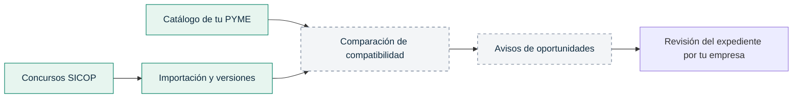

<p align="center">
  
</p>

<h1 align="center">NexoLicitCR</h1>
<p align="center"><strong>Automatizamos la búsqueda. Tu PYME construye el futuro.</strong></p>
<p align="center">Catálogo empresarial · Concursos SICOP · Automatización progresiva</p>

---

NexoLicitCR busca acercar las compras públicas de Costa Rica a las pequeñas y medianas empresas. Su objetivo es conectar lo que tu empresa ofrece con lo que las instituciones necesitan, reducir la revisión repetitiva de concursos y ayudarte a decidir cuáles merecen atención.

**La base actual permite registrar tu catálogo e importar y consultar concursos de SICOP.** La comparación automática de compatibilidades y los avisos todavía están en desarrollo; no se determina automáticamente si una empresa cumple todos los requisitos para participar.

## Pensado para tu empresa

| Necesidad de la PYME | Cómo la aborda el proyecto |
|---|---|
| Explicar qué vende y qué puede hacer | Catálogo de productos y servicios, capacidades, cobertura y palabras clave. |
| Consultar oportunidades en un solo lugar | Importación de concursos de bienes, obras y servicios, con detalle y líneas solicitadas. |
| Identificar cambios en lo consultado | Versiones por contenido y registro de las corridas de importación. |
| Reducir la búsqueda repetitiva | Base de ingesta bajo demanda; ejecución programada prevista en una etapa posterior. |
| Priorizar oportunidades afines | Comparación con el catálogo y avisos previstos; aún no disponibles. |

## Del catálogo a la oportunidad



Las cajas discontinuas representan funciones previstas. Una compatibilidad futura será una señal para revisar el expediente, no una garantía de admisibilidad ni de adjudicación.

## Estado del producto

| Disponible en esta base | Próximas etapas |
|---|---|
| Administrador único y sesiones persistentes | Ejecución programada y worker duradero |
| Creación, edición y desactivación de ítems del catálogo | Descarga de anexos y extracción de texto/OCR |
| Ingesta manual con paginación, fallos registrados y versiones | Comparación explicable entre catálogo y requisitos |
| Búsqueda y detalle de concursos importados | Avisos y priorización de oportunidades |

**Validaciones pendientes:** integración contra una base Atlas real, muestras de anexos y confirmación de la zona horaria de fechas SICOP sin offset.

## Arquitectura

Un **monolito modular Python**, ejecutable localmente bajo demanda o en un servidor:

- **FastAPI + Jinja2:** aplicación web con HTML/CSS y autenticación.
- **CLI compartida:** inicialización, creación del administrador e ingesta SICOP.
- **MongoDB Atlas o MongoDB local:** única persistencia para catálogo, sesiones, concursos y versiones.
- **Redis opcional:** reservado para caché futura; no se requiere ni se utiliza actualmente.

No requiere un segundo backend. Atlas y la ingesta real de SICOP necesitan Internet; MongoDB local permite probar la UI y fixtures sin esos servicios.

## Instalación

Requiere Python 3.12 o 3.13, uv y una base de desarrollo en Atlas con permisos de lectura/escritura e índices. La ejecución local también requiere Internet para Atlas.

```bash
uv sync --frozen
cp .env.example .env
```

Completar `.env` localmente:

| Variable | Uso |
|---|---|
| `ATLAS_URI` | URI `mongodb+srv://...mongodb.net/` sin usuario ni contraseña. |
| `ATLAS_USUARIO`, `ATLAS_CLAVE` | Credenciales; se pasan a PyMongo sin concatenación. |
| `ATLAS_BASE` | Base exclusiva de esta instalación. |
| `ATLAS_AUTHDB` | Base de autenticación, normalmente `admin`. |
| `APP_MODE` | `local` o `server`. |
| `PUBLIC_ORIGIN` | Origen exacto del navegador; local: `http://localhost:8000`. |
| `SICOP_TIMEZONE` | Vacío conserva fechas sin zona como pendientes; configurar una zona IANA solo después de validar su significado. |
| `REDIS_URL` | Reservado para la futura caché opcional. |

`MONGO_MODE=atlas` es el valor predeterminado. TLS Atlas siempre está habilitado. No se admiten opciones que relajen la validación de certificados. `.env` nunca debe versionarse.

```bash
uv run nexolicit init-db
uv run nexolicit create-admin
uv run nexolicit api
```

Abrir `http://localhost:8000`. Crear administrador solicita la contraseña por entrada oculta (14–256 caracteres), sin contraseña predeterminada. Solo permite un administrador; no reemplaza cuentas existentes. Inicializar índices es idempotente y no borra colecciones. Mantener credenciales y copias de seguridad fuera de Git.

Para servidor: configurar `APP_MODE=server`, origen HTTPS y un proxy TLS que preserve el Host; exponer exclusivamente el proxy y restringir el puerto del backend. El servidor no confía automáticamente en cabeceras reenviadas. Este repositorio no provisiona Atlas ni despliega servicios públicos.

## Desarrollo con MongoDB local

La UI existente incluye login, catálogo, búsqueda y detalle de concursos. Para probarla sin Atlas, usar MongoDB Community como **replica set de un nodo**; un servidor standalone no permite las transacciones utilizadas por la ingesta. Compass administra el servidor, pero no lo reemplaza.

Instalar el binario oficial `mongod` siguiendo la [guía de MongoDB](https://www.mongodb.com/docs/v8.0/tutorial/install-mongodb-on-os-x-tarball/). Se puede extraer dentro de `var/tools/`, que está ignorado. El helper utiliza el puerto 27017 y no reemplaza un `.env` existente:

```bash
uv sync --frozen
uv run python scripts/local_mongo.py start --mongod /ruta/al/binario/mongod
uv run nexolicit create-admin
uv run nexolicit api
```

El helper crea `.env` con permisos 0600, claves aleatorias, autenticación y un replica set `nexo-local` enlazado exclusivamente a `127.0.0.1`. Inicializa `nexolicit_local` e índices. El usuario de la aplicación tiene permisos `readWrite` exclusivamente en `nexolicit_local` y `nexolicit_test_local`. Las credenciales administrativas y la clave del replica set quedan en `var/mongodb/`, fuera de Git. No borrar esa carpeta si se desea conservar los datos. Los reinicios usan el mismo comando `start`.

`MONGO_MODE=local` utiliza exclusivamente las variables `MONGO_LOCAL_*` de [.env.local.example](.env.local.example); no requiere credenciales Atlas. Solo se admite con `APP_MODE=local`, URI `mongodb://127.0.0.1:27017/?replicaSet=nexo-local` (puerto explícito), sin credenciales embebidas ni opciones adicionales. TLS se mantiene obligatorio para Atlas. En local, el transporte sin TLS queda limitado a loopback y requiere autenticación.

Abrir `http://localhost:8000`. En Compass, conectar con la URI local del `.env` y configurar autenticación Username/Password, usuario y clave `MONGO_LOCAL_USUARIO` / `MONGO_LOCAL_CLAVE`, y Authentication Database `admin`. No pegar credenciales en capturas, commits ni el PR.

Prueba real con fixture sintético, sin consultar SICOP:

```bash
NEXO_TEST_LOCAL=1 NEXO_TEST_DATABASE=nexolicit_test_local uv run pytest -m integration
```

Verifica escritura transaccional, reimportación idempotente y rollback entre colecciones. La selección de pruebas debe coincidir con `MONGO_MODE`. Nunca usar una base compartida. Un solo nodo no comprueba tolerancia a fallos ni alta disponibilidad.

Para detener la API: Ctrl+C en su terminal. Para detener MongoDB conservando los datos:

```bash
uv run python scripts/local_mongo.py stop
```

## Importación manual

```bash
uv run nexolicit sync --category bienes --limit 10
uv run nexolicit sync --category all --limit 5 --since 2026-01-01
```

`limit` limita los concursos procesados por rubro, no el número de solicitudes necesarias para filtrar fechas. La corrida queda registrada; una importación parcial termina con código de error. Las fechas se filtran del lado del cliente y no se presupone orden descendente perfecto. No se usa una marca de agua que oculte actualizaciones: las corridas acotadas revisitan los registros consultados; para cobertura histórica/activos fuera de ese rango se requieren barridos adicionales. Máximo 100 páginas por recurso; alcanzar el límite se informa como consulta incompleta.

La fecha de cierre se toma del detalle (`biddocEndDt`), nunca de la apertura. Condiciones referidas a anexos no implican ausencia de requisitos. Precios de líneas son presupuestados, no adjudicados. El JSON se interpreta con decimales exactos y se guarda como texto decimal; unidades desconocidas permanecen desconocidas.

Las versiones y el estado actual se guardan en una transacción MongoDB con mayoría; un fallo revierte la escritura. Un registro observado antes que el almacenado no lo reemplaza. Cada secuencia SICOP se conserva separada hasta validar su relación; no se mezclan expedientes arbitrariamente.

## Pruebas

```bash
uv run ruff check src tests scripts
uv run ruff format --check src tests scripts
uv run pytest -m 'not integration'
uv run python scripts/check_publishable.py
```

Fixtures sintéticas con estructura observada de SICOP; no contienen instituciones ni personas reales. Las pruebas con mongomock comprueban lógica y HTTP, no transacciones de MongoDB real. Las de integración están separadas y no consultan SICOP en CI.

Para verificar Atlas de forma explícita, configurar `.env` y una base de prueba cuyo nombre empiece por `nexolicit_test_`:

```bash
NEXO_TEST_ATLAS=1 NEXO_TEST_DATABASE=nexolicit_test_integration uv run pytest -m integration
```

La prueba crea índices y catálogo inicial si faltan; limpia únicamente los documentos de concursos que ella creó, nunca toda la base. Usar una base descartable dedicada. Redis y OCR no se simulan como funcionalidades terminadas.

## Privacidad y límites

El catálogo y las sesiones se guardan en la base MongoDB seleccionada. `.gitignore` excluye credenciales, entornos, logs, descargas, datos de ejecución y planificación local. Lockfile, ejemplos sanitizados y fixtures sí se versionan. Revisar manualmente metadatos de archivos y autoría de commits antes de publicar; la comprobación automática complementa esa revisión.

No se han confirmado todos los requisitos necesarios para participar a partir de la API: varias condiciones remiten al pliego. Revisar el expediente original. La interpretación de fechas sin offset y las muestras de anexos digitales/escaneados siguen pendientes de validación integral. No confundir precios ofertados o presupuestados con adjudicaciones finales.


## Identidad y licencia

El símbolo conecta módulos para formar una **N** y una dirección de avance: representa a una PYME que transforma información dispersa en oportunidades mediante automatización. El azul profundo aporta solidez y el verde identifica conexión y crecimiento.

Distribuido bajo la [licencia MIT](LICENSE).
