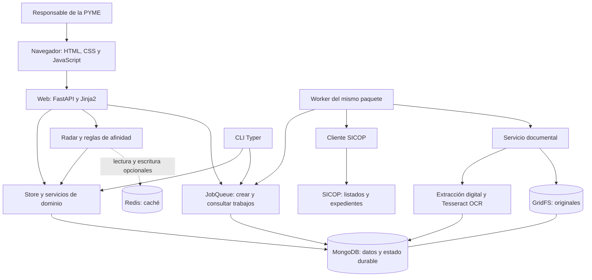
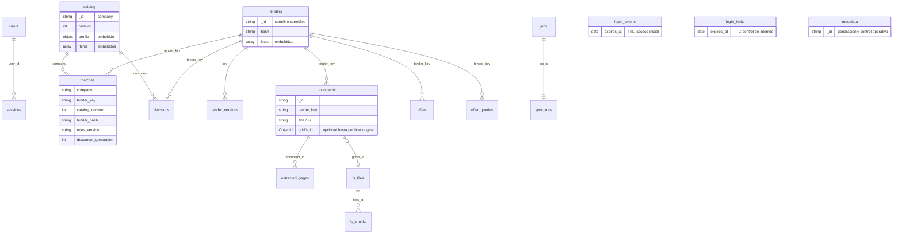
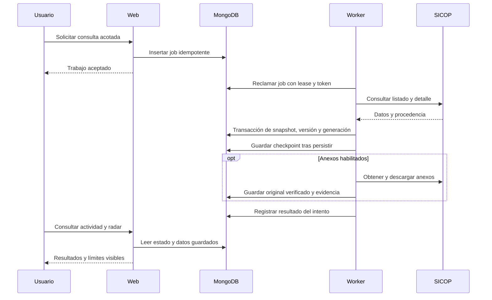

# NexoLicitCR: documentación integral del proyecto y uso de asistentes de IA

**Proyecto:** radar de oportunidades de contratación pública para PYMES de Costa Rica.  
**Asignatura:** Tópicos Avanzados de Bases de Datos, Universidad Nacional.  
**Equipo:** Esteban Sánchez, José Guadamuz, Akion Cheng y Adriana Morera.  
**Edición:** 27 de octubre de 2026, zona horaria America/Costa_Rica.  
**Versión del paquete documentado:** 0.9.0.

Este documento explica el producto, su arquitectura y las razones de diseño, el modelo de datos, la operación, la evidencia de validación y el uso de asistentes durante el desarrollo. Se basa en el código y los documentos del repositorio. Los resultados experimentales conservan su fecha y entorno; redactar esta documentación no implica volver a ejecutar los experimentos.

La atribución de herramientas de IA fue confirmada por Esteban el 27 de octubre: sus tareas utilizaron GPT-6 Astra con apoyo de GPT-6.1 Sol; las de Akion y José Guadamuz utilizaron Claude Code. El historial Git permite identificar contribuciones humanas, pero no permite determinar por sí solo qué modelo produjo cada fragmento.

## Índice

1. [Problema, objetivos y usuarios](#1-problema-objetivos-y-usuarios)
2. [Alcance funcional](#2-alcance-funcional)
3. [Arquitectura general](#3-arquitectura-general)
4. [Por qué se eligió esta arquitectura](#4-por-qué-se-eligió-esta-arquitectura)
5. [Modelo de datos e índices](#5-modelo-de-datos-e-índices)
6. [Flujos, consistencia y recuperación](#6-flujos-consistencia-y-recuperación)
7. [Afinidad y descubrimiento empresarial](#7-afinidad-y-descubrimiento-empresarial)
8. [Documentos y OCR](#8-documentos-y-ocr)
9. [Seguridad y aislamiento](#9-seguridad-y-aislamiento)
10. [Organización del código](#10-organización-del-código)
11. [Instalación y configuración](#11-instalación-y-configuración)
12. [Interfaz web y comandos](#12-interfaz-web-y-comandos)
13. [Pruebas y resultados](#13-pruebas-y-resultados)
14. [Operación y mantenimiento](#14-operación-y-mantenimiento)
15. [Equipo, asistentes y trazabilidad](#15-equipo-asistentes-y-trazabilidad)
16. [Limitaciones y evolución](#16-limitaciones-y-evolución)
17. [Glosario](#17-glosario)
18. [Fuentes del proyecto](#18-fuentes-del-proyecto)

## 1. Problema, objetivos y usuarios

Una PYME necesita revisar publicaciones, fechas de recepción, partidas, requisitos y anexos de contratación pública. Esa información se encuentra repartida entre listados y expedientes. La revisión manual puede repetirse cada vez que cambia el catálogo de la empresa o se vuelve a consultar un concurso; también es fácil perder el motivo por el cual una oportunidad se siguió o descartó.

NexoLicitCR reúne el perfil y catálogo empresarial, un conjunto acotado de concursos de SICOP, evidencia documental y decisiones de seguimiento. Su función es ayudar a priorizar la revisión y conservar contexto. No sustituye el expediente oficial ni determina que una empresa cumpla todos los requisitos de participación.

### Objetivo general

Construir una aplicación reproducible que relacione las capacidades de una PYME con concursos públicos, explique las coincidencias y conserve documentos y decisiones mediante una arquitectura de datos coherente.

### Objetivos específicos

- Registrar y confirmar un perfil empresarial y un catálogo editable.
- Consultar SICOP con límites explícitos, procedencia y fechas de observación.
- Conservar el estado de los concursos y sus cambios sin duplicar versiones idénticas.
- Guardar originales documentales íntegros y extraer texto por página.
- Mostrar razones de afinidad y advertencias cuando la evidencia esté incompleta.
- Mantener decisiones y notas aunque cambie el catálogo o se recalcule el radar.
- Recuperar trabajos interrumpidos y continuar operando cuando la caché no esté disponible.
- Documentar instalación, pruebas y mediciones para que otra persona pueda evaluar el proyecto.

| Usuario o participante | Necesidad |
|---|---|
| Responsable comercial de la PYME | Identificar concursos que merezcan revisión y conservar sus decisiones. |
| Administrador de la instalación | Configurar conexiones, crear la cuenta inicial y mantener web y worker. |
| Equipo de desarrollo | Mantener el código, revisar cambios y reproducir resultados. |
| Docente o evaluador | Examinar arquitectura, modelado, índices, transacciones, fallos y evidencia. |

El diseño implementa **una empresa, una base MongoDB exclusiva y una cuenta administradora por instalación**. Los perfiles anteriores describen necesidades; no son roles de autorización separados dentro del producto.

## 2. Alcance funcional

| Área | Comportamiento implementado | Límite que debe conservarse |
|---|---|---|
| Acceso | Registro inicial, login, logout y sesiones persistentes. | El registro se cierra cuando ya existe la cuenta inicial. |
| Empresa | Actividad, sector, varias especialidades y sugerencias confirmadas por la persona. | Las sugerencias no certifican capacidades de la empresa. |
| Catálogo | Ítems, términos, exclusiones, cobertura y códigos de clasificación. | Los cambios requieren una revisión vigente para evitar sobrescrituras. |
| Fuente | Consulta acotada por rubro, importación y actualización de concursos guardados. | El corpus local no representa todo SICOP. |
| Actividad | Cola durable, progreso, reintentos, cancelación y reanudación. | Una consulta parcial conserva avances, pero no se presenta como completa. |
| Radar | Coincidencias explicadas, filtros y estado actual del concurso. | El puntaje no es probabilidad de adjudicación ni elegibilidad. |
| Evidencia | Originales GridFS, texto digital/OCR por página y estados parciales. | Formatos y recursos de extracción limitados. |
| Decisiones | Relevante, seguimiento, descarte o sin clasificación, con nota. | No envía ofertas ni comentarios a SICOP. |
| Histórico opcional | Ofertas presentadas por partida y resultado de su consulta. | No equivale a adjudicaciones finales ni a precios unitarios comparables. |

La presencia del contrato `Award` en el código reserva una estructura futura. No implica que exista un importador operativo de adjudicaciones finales.

## 3. Arquitectura general

NexoLicitCR es un monolito modular de Python. FastAPI atiende las solicitudes y Jinja2 genera HTML. La CLI y el worker reutilizan el mismo paquete y los mismos contratos. Web y worker pueden ejecutarse como procesos separados sin convertirse en servicios con implementaciones independientes.



**Responsabilidades:** MongoDB conserva el estado duradero; Redis reutiliza resultados derivados; GridFS conserva binarios dentro del ecosistema MongoDB; el worker realiza consultas y extracción; la web presenta resultados y recibe decisiones. SICOP sigue siendo la fuente externa cuya disponibilidad y contenido no controla el proyecto.

### Formas de ejecución

| Modalidad | Procesos y persistencia |
|---|---|
| Nativa con MongoDB local | API y worker local supervisado; MongoDB autenticado como replica set de un nodo. |
| Nativa con Atlas | Mismo paquete; conexión a una base exclusiva en Atlas. |
| Docker Compose con Atlas | Servicios `init-db`, `web` y `worker`; Redis opcional mediante perfil `cache`. |
| Demo sintética | Base y puertos propios; escenario ficticio y API sin consultas externas. |

Compose no instala MongoDB local: usa Atlas externo. El replica set local permite demostrar transacciones, pero un solo nodo no acredita alta disponibilidad.

## 4. Por qué se eligió esta arquitectura

Las decisiones responden al alcance académico y al recorrido del producto. Las alternativas de esta sección explican los costos del diseño; no se presentan como experimentos comparativos si no hay una medición que los respalde.

### 4.1 Monolito modular y renderizado en servidor

El recorrido principal comparte autenticación, empresa, concursos, documentos y decisiones. Mantenerlo en un paquete permite reutilizar modelos, configuración y acceso a datos, y reduce la cantidad de despliegues y contratos de red que el grupo debe mantener.

FastAPI/Jinja2 permite formularios y páginas funcionales sin una aplicación frontend separada. HTML, CSS y JavaScript nativo cubren la interacción actual. Esto facilita instalar y demostrar el sistema sin agregar un proceso de compilación de una SPA ni dependencias de un CDN.

**Alternativa:** microservicios y frontend independiente. Serían útiles si existieran equipos, ciclos de despliegue o necesidades de escalado claramente separados. En el alcance actual introducirían autenticación entre servicios, contratos adicionales y más operación. El monolito conserva el costo de desplegar conjuntamente sus módulos y exige mantener separadas sus responsabilidades internas.

### 4.2 MongoDB como fuente de verdad

Un concurso combina metadatos, condiciones y líneas cuyo contenido puede variar. El almacenamiento documental permite conservar una representación normalizada cercana al expediente, junto con su procedencia. También permite utilizar índices, transacciones y GridFS con el mismo sistema de persistencia.

El catálogo embebe sus ítems porque es un agregado pequeño que se consulta y revisa como unidad. En cambio, versiones, documentos, páginas y trabajos se separan: crecen de forma distinta y necesitan identidades e índices propios. Evitar que todo quede dentro del documento del concurso limita su crecimiento y permite consultar cada área de forma independiente.

**Costo:** MongoDB no impone claves foráneas entre estas colecciones. El código debe conservar referencias válidas, índices y reglas de actualización. Su flexibilidad no reemplaza los contratos Pydantic ni la validación en las operaciones.

### 4.3 Por qué no se incorporó SQLite en la implementación actual

La arquitectura vigente asigna catálogo, sesiones, decisiones, versiones y trabajos a MongoDB. Añadir SQLite para duplicar esa persistencia obligaría a definir sincronización entre motores, resolución de conflictos y recuperación de escrituras parciales.

El producto actual no implementa un cliente autónomo que deba escribir sin conexión a MongoDB. Por eso SQLite no tiene una responsabilidad indispensable en esta versión. Podría ser apropiado para un futuro cliente offline, siempre que se diseñe su protocolo de sincronización. Su ausencia no se reemplaza con una afirmación de funcionamiento offline: si MongoDB deja de estar disponible, las operaciones dependientes de persistencia fallan de forma explícita.

### 4.4 Redis opcional para resultados derivados

Calcular repetidamente el radar sobre un catálogo y corpus sin cambios produce trabajo reutilizable. Redis almacena el resultado serializado del cálculo. Las claves incluyen versiones suficientes para que un cambio de catálogo, reglas o corpus deje de reutilizar el resultado anterior.

**Por qué es opcional:** la caché no debe ser la única copia del catálogo ni de las decisiones. Si Redis falla, la aplicación calcula desde MongoDB. El beneficio esperado es evitar cálculo repetido, sin convertir una caída de caché en pérdida de datos.

**Costo:** hay serialización, acceso al servidor y lecturas de MongoDB que siguen siendo necesarias. Un hit de Redis no significa que toda la respuesta salga sin consultar la base. Los resultados grandes pueden omitir la caché; el microbenchmark en memoria no permite predecir la latencia de Redis en red.

### 4.5 GridFS para originales documentales

Conservar solo texto extraído impediría volver al documento que lo originó. GridFS permite guardar y recuperar el original mediante una identidad persistente, separado de sus páginas de texto, con comprobaciones de tamaño y SHA-256.

**Alternativas:** archivos en disco u otro servicio de objetos. El disco local exigiría coordinar rutas, permisos, despliegues y respaldos con MongoDB; un servicio externo agregaría otra dependencia de operación. GridFS concentra la responsabilidad de persistencia del MVP, a cambio de aumentar el volumen y el costo de respaldar MongoDB.

GridFS y el estado de negocio no forman una única operación transaccional indivisible: primero se carga y verifica el binario y después se publica su referencia. Por ello existen estados de recuperación y un reporte de huérfanos. No se promete ausencia absoluta de archivos sin referencia.

### 4.6 Transacciones para publicar un estado coherente

Guardar el snapshot de un concurso sin su versión, o actualizar el corpus sin publicar sus datos, permitiría respuestas incoherentes. `Store.save_tender` publica snapshot, versión y actualización de generación dentro de una transacción con lectura `snapshot` y escritura `majority`.

Un hash identifica el contenido normalizado. Una reingesta idéntica actualiza la observación sin crear una versión distinta; una observación más antigua no reemplaza una más reciente. El hash es una comprobación de identidad de contenido, no una validación de la veracidad del expediente.

**Costo:** se necesita MongoDB con soporte de transacciones, mediante replica set o Atlas. El código no degrada silenciosamente esas operaciones a escrituras no atómicas en un servidor standalone.

### 4.7 Cola durable en MongoDB y worker separado

Consultar la fuente, descargar anexos y ejecutar OCR puede durar más que una solicitud web. La web registra un trabajo; el worker lo procesa y guarda su avance. Mantener la cola en MongoDB permite que checkpoints, idempotencia y estado operativo sobrevivan a reinicios sin requerir Redis para trabajar.

Un **lease** concede temporalmente un trabajo a un worker. Un token de **fencing** impide que un worker cuyo permiso venció confirme escrituras después de que otro lo recupere. Esta protección importa más que simplemente volver a iniciar un proceso.

**Alternativa:** una cola externa especializada. Podría aportar funcionalidades útiles a mayor escala, pero agregaría otro sistema obligatorio y coordinación con la persistencia del dominio. El diseño actual concentra esas garantías en MongoDB. Su costo incluye consultas periódicas a la cola, contención potencial y la necesidad de supervisar procesos.

### 4.8 Reglas explicables para la afinidad

El radar utiliza términos, códigos seleccionados y evidencia por página. Se puede mostrar qué coincidencia produjo el puntaje y probar la función con entradas conocidas. No necesita una llamada a un modelo generativo para responder.

Esto hace reproducible el cálculo y permite separar una razón de coincidencia de una decisión de participación. El costo es una cobertura semántica limitada: vocabulario inesperado, ambigüedad y errores de OCR pueden producir falsos positivos o negativos. Usar reglas no elimina la necesidad de evaluar relevancia con personas.

### 4.9 Una empresa por instalación

La cuenta inicial, el catálogo y las decisiones se diseñaron para una PYME. Una base exclusiva reduce las combinaciones de permisos y evita presentar una separación parcial como un SaaS multiempresa.

`INSTALLATION_ID` separa trabajos y participa en claves de caché; **no sustituye un modelo de autorización multiempresa**. Para compartir una instalación entre varias empresas harían falta cambios en identidades, consultas, permisos, sesiones y pruebas de aislamiento.

## 5. Modelo de datos e índices

### 5.1 Colecciones

| Colección | Contenido y relación principal |
|---|---|
| `users` | Cuenta administradora fija, nombre único, hash de contraseña y estado activo. |
| `sessions` | Hash del token de sesión, usuario, CSRF y expiración. |
| `login_tokens` | Tokens temporales del formulario de acceso. |
| `login_limits` | Contadores de intentos por identificadores hash y ventana temporal. |
| `catalog` | Documento `_id=company`, perfil, ítems embebidos y revisión monotónica. |
| `tenders` | Snapshot actual por `cartelNo:cartelSeq`, hash, estado y fecha de observación. |
| `tender_versions` | Versiones por identidad del concurso y hash del contenido. |
| `documents` | Identidad del anexo, concurso, hash, estado y referencia del original. |
| `fs.files` / `fs.chunks` | Metadatos y fragmentos de los originales GridFS. |
| `extracted_pages` | Texto por documento/página, método, versión del extractor y error. |
| `matches` | Afinidad derivada y versiones que identifican el cálculo. |
| `decisions` | Estado y nota de la empresa para un concurso; independiente del cálculo. |
| `offers` | Ofertas presentadas, partida, precio, moneda, procedencia y posición. |
| `offer_queries` | Resultado de consulta del histórico por concurso y partida. |
| `jobs` | Payload, idempotencia, estado, lease, token, intentos y checkpoints. |
| `sync_runs` | Resumen de ejecuciones terminales. |
| `metadata` | Generación del corpus y metadatos operativos. |

La tabla incorpora `offer_queries`, usada por el código del histórico, aunque algunos diagramas anteriores no la enumeran.

### 5.2 Contratos relevantes

- `Tender` preserva identificador, secuencia, procedimiento, institución, categoría, estado, condiciones y líneas. `requirements_complete` permanece explícitamente falso: importar metadatos no acredita conocer todos los requisitos.
- `SourceDate` conserva el texto original, una fecha UTC cuando puede interpretarse y la zona asumida. Un valor desconocido no se transforma en una fecha inventada.
- `TenderLine` utiliza `Decimal` para cantidades e importes. La serialización JSON los conserva como texto para evitar pérdida por conversión a coma flotante.
- `CatalogItem` exige sistema y código de clasificación juntos; permite palabras clave y exclusiones.
- `CompanyProfile` admite hasta ocho especialidades y valida los servicios seleccionados.
- `JobPayload` limita la consulta a 1–500 entradas por el criterio implementado y registra rubro, anexos y revisión del perfil.
- `Offer` distingue precio presentado de adjudicación; `unit_price` y `awarded` no se infieren.

### 5.3 Índices y motivo de uso

| Índice | Propósito |
|---|---|
| `users.username`, único | Evitar nombres de acceso duplicados. |
| TTL sobre `expires_at` en sesiones y tokens | Retirar registros vencidos; la aplicación comprueba expiración sin esperar la limpieza TTL. |
| `tenders(status, deadline_utc)` | Apoyar la selección por estado y cierre. |
| `tenders.observed_at` | Facilitar la selección de observaciones que deben reconsultarse. |
| `tender_versions(key, hash)`, único | Evitar versiones duplicadas de un mismo contenido. |
| `jobs(installation_id, idempotency_key)`, único | Evitar encolar dos veces la misma petición de una instalación. |
| `jobs(installation_id, status, next_attempt_at, lease_until)` | Apoyar la búsqueda de trabajos elegibles y recuperables. |
| `decisions(company, tender_key)`, único | Mantener una decisión por empresa/concurso. |
| Índice compuesto de identidad en `matches` | Separar resultados por catálogo, concurso, reglas y generación documental. |
| `documents(tender_key, source_identity, sha256)`, único | Identificar una versión concreta del anexo. |
| `fs.files.metadata.sha256` | Buscar candidatos a reutilización de contenido íntegro. |
| `extracted_pages(document_id, page)`, único | Evitar duplicación de una página extraída. |
| `offers(tender_key, lot, source_hash, position)`, único | Conservar ofertas de distintas partidas y observaciones. |
| `offer_queries(tender_key, lot)`, único | Mantener el resultado de consulta por partida. |

Los índices únicos protegen invariantes además de facilitar búsquedas. Los índices secundarios consumen espacio y trabajo de escritura; su utilidad se evalúa con las consultas efectivas y sus planes, no por la cantidad de índices creados. `nexolicit init-db` crea los índices y contempla la retirada del índice legado de ofertas que no incluía la partida.

### 5.4 Diagrama de la base de datos

[Diagrama vectorial SVG](diagramas/modelo-datos.svg) · [Documento completo en PDF](entrega/DOCUMENTACION_PROYECTO_Y_AGENTES.pdf).

El diagrama muestra referencias lógicas entre colecciones MongoDB. Las relaciones no son claves foráneas impuestas por el motor. `catalog` contiene el perfil y los ítems embebidos; no existe una colección `companies` separada. Los vínculos con concursos usan `tender_key`, salvo `tender_versions`, que utiliza `key`.



**Lectura:** `||` indica uno; `o{`, cero o muchos; `o|`, cero o uno. `fs_files` y `fs_chunks` representan los nombres reales `fs.files` y `fs.chunks`. Un documento pendiente puede no tener original; un original puede ser reutilizado por varios documentos. Los huérfanos de GridFS se revisan con el diagnóstico documentado. El esquema expresa la relación prevista, no garantiza ausencia física de huérfanos.

Las colecciones `login_tokens`, `login_limits` y `metadata` no requieren una relación de propiedad con cada concurso. Los trabajos conservan payload y checkpoints embebidos; `sync_runs` guarda su resumen terminal. Redis queda fuera de este diagrama porque su contenido es una caché derivada y opcional.

## 6. Flujos, consistencia y recuperación

### 6.1 Del perfil a la decisión

1. La persona registra la primera cuenta e inicia sesión.
2. Describe su actividad, selecciona especialidades y confirma las sugerencias.
3. Revisa o amplía su catálogo manual.
4. Abre el radar sobre el corpus guardado; una actualización externa exige una acción explícita.
5. Solicita una consulta limitada y observa su actividad.
6. Revisa razones de afinidad, fecha de verificación, expediente y evidencia disponible.
7. Guarda una decisión y una nota. Estas permanecen aunque cambie el catálogo.

### 6.2 Ingesta y publicación



El límite de la consulta no significa necesariamente ese número de concursos nuevos: cada rubro puede reconsultar activos guardados además de recorrer una ventana del listado. Se evita procesar dos veces la misma identidad dentro de un intento. Los contadores deben interpretarse según el alcance documentado.

### 6.3 Estados de trabajo

| Estado | Interpretación |
|---|---|
| `queued` | Espera una oportunidad de ejecución. |
| `running` | Un worker posee un lease vigente. |
| `retry_wait` | Espera antes de otro intento permitido. |
| `succeeded` | Completó el trabajo según sus condiciones. |
| `failed` | No completó el trabajo y requiere revisar su causa. |
| `canceled` | Se canceló conservando la evidencia ya persistida. |

El worker renueva el lease y verifica su permiso antes de escribir. La recuperación conserva checkpoints. Cancelar es cooperativo: una descarga o extracción puede tardar hasta su límite antes de llegar a un punto de control.

HTTP 429 pausa la fuente, conserva el avance y respeta `Retry-After` dentro de los límites implementados. Sin plazo del proveedor se utiliza una espera predeterminada de cinco minutos. La pausa queda persistida y afecta a nuevos trabajos SICOP de la misma instalación; no desaparece por reiniciar el proceso.

Reanudar un trabajo fallido o cancelado crea una continuación con progreso previo. No convierte el trabajo original en exitoso ni elimina su historial. La renovación del presupuesto de intentos es una acción explícita.

### 6.4 Comportamiento ante fallos

| Evento | Respuesta prevista | Límite |
|---|---|---|
| Redis ausente o caído | Recalcular desde MongoDB y mostrar estado de caché. | La respuesta puede tardar más. |
| MongoDB no disponible | Informar indisponibilidad; el worker continuo vuelve a intentar la conexión. | No hay almacenamiento SQLite alternativo ni operación completa offline. |
| Caída del worker | Recuperar el job cuando corresponda y continuar desde checkpoints. | Requiere otro worker activo o reiniciar el proceso. |
| Worker con lease vencido | Rechazar escrituras mediante fencing. | No basta con comprobar solo el PID del proceso. |
| Reinicio de API | Leer sesiones y catálogo persistidos. | Una sesión expirada o revocada sigue siendo inválida. |
| Anexo incompatible o incompleto | Conservar estado y error, sin equipararlo a ausencia de requisitos. | La afinidad puede usar evidencia parcial. |
| Cambios concurrentes del catálogo | Detectar revisión desactualizada y responder con conflicto. | La persona debe recargar antes de guardar de nuevo. |

## 7. Afinidad y descubrimiento empresarial

`sectors.py` y `discovery.py` orientan el perfil mediante vocabulario y reglas. La confirmación humana separa una sugerencia de una capacidad declarada. `matching.py` calcula las coincidencias y conserva la versión de reglas `2026-10-v3` en el código revisado.

| Evidencia | Peso del cálculo actual |
|---|---:|
| Término en título | 35 |
| Término en descripción de línea | 30 |
| Término en texto documental | 15 |
| Código SICOP exacto seleccionado en el catálogo | 40 |

Para cada ítem activo, las coincidencias se deduplican por método y término normalizado, se suman y se limitan a 100. El puntaje del concurso es el máximo entre sus ítems coincidentes, no una suma ilimitada de todos los productos del catálogo.

Las exclusiones encontradas en fuentes tratadas como fiables por las reglas pueden dejar en cero el puntaje del ítem. Una exclusión detectada por OCR señala revisión requerida. Se conservan fragmento, término, método y referencia de página o línea. «Fiable» en este contexto es una regla de tratamiento del texto, no una certificación de exactitud del documento.

El estado preliminar señala falta o error de evidencia. Las decisiones se leen aparte del resultado cacheado. Los cierres se recalculan para evitar que un concurso continúe mostrándose vigente solo porque existe una entrada de caché.

### Caché

La clave combina namespace, entorno, instalación, identidad de base, empresa, recurso, revisión de catálogo, versión de reglas, generación del corpus y filtros. El TTL predeterminado es 120 segundos; el timeout es 150 ms y la pausa tras fallo, 30 segundos. Cada valor admite hasta 4 MiB; superar ese tamaño produce bypass.

La aplicación no ejecuta `FLUSHDB`, `FLUSHALL` ni recorridos globales de claves para invalidar. Al cambiar una versión, utiliza una clave distinta. El prefijo reduce colisiones accidentales, pero los permisos de un Redis compartido requieren configuración ACL propia.

## 8. Documentos y OCR

El servicio obtiene metadatos de anexos, verifica el destino de descarga, limita tamaño y reconoce los formatos admitidos. Acepta PDF, PNG y JPEG; Word y ZIP no forman parte de la extracción implementada.

| Límite predeterminado | Valor |
|---|---:|
| Tamaño por archivo | 20 MiB |
| Anexos por concurso | 5 |
| Páginas por documento | 30 |
| Tiempo total de extracción | 120 segundos |

La extracción digital utiliza `pypdf`. Las páginas con poco texto o características que justifican OCR se renderizan y procesan con Tesseract en español. Los resultados conservan página, método y versión `pdf-ocr-v2`; una página sin texto disponible mantiene un error o estado explícito.

La extracción ocurre en un subproceso. En sistemas POSIX se aplican límites de CPU y tamaño de archivo; Linux añade un límite de memoria virtual de 1 GiB. En Windows no se dispone del mismo mecanismo `resource`, por lo que el límite del proceso padre tiene un papel distinto. Las observaciones antiguas sobre incompatibilidad Windows deben leerse junto con las correcciones posteriores, no como descripción única del código actual.

Un archivo ya guardado solo se reutiliza después de comprobar tamaño y contenido. La recuperación puede reparar documentos marcados como listos cuyo original ya no sea válido. `document-orphans` informa archivos o fragmentos potencialmente huérfanos; no los elimina, porque algunos pueden pertenecer a una carga activa.

## 9. Seguridad y aislamiento

### Identidad y sesiones

- Contraseñas de 14–256 caracteres con hash mediante `pwdlib` y Argon2.
- Identidad fija del administrador para impedir dos altas iniciales concurrentes.
- Tokens de sesión aleatorios; MongoDB conserva el hash del token de acceso.
- Cookies `HttpOnly`, `SameSite=Strict` y `Secure` cuando el origen es HTTPS.
- Expiración comprobada por la aplicación y limpieza TTL en MongoDB.
- Logout revoca la sesión persistida; el registro no funciona como recuperación de contraseña.
- Límites de intentos de acceso por ventana, con identificadores hash para dirección y usuario.

### Solicitudes y documentos externos

Las operaciones que modifican estado comprueban el origen configurado y los formularios utilizan CSRF. Las respuestas incluyen una política CSP restringida al mismo origen y cabeceras contra interpretación de tipos incorrectos y referencias externas. Los errores de persistencia se presentan sin exponer credenciales.

Las descargas restringen HTTPS, hosts permitidos, tamaño y destinos de red. Las URLs firmadas de anexos son datos temporales de acceso y no se incluyen como credenciales en la documentación. Texto de un expediente u OCR es contenido externo, no una instrucción administrativa.

### Configuración y despliegue

`.env`, credenciales, datos locales, temporales y registros de ejecución quedan fuera de Git. Los ejemplos de configuración son los archivos versionados que se comparten. Atlas usa credenciales separadas de la URI y TLS; el modo local requiere loopback y replica set autenticado.

Docker ejecuta el paquete con usuario no privilegiado, raíz de solo lectura, temporales definidos y capacidades reducidas. Estas medidas forman parte del diseño; no equivalen a una certificación de seguridad, una auditoría integral de dependencias o una autorización para compartir bases entre empresas.

## 10. Organización del código

| Ruta o módulo | Responsabilidad |
|---|---|
| `src/nexolicitcr/config.py` | Variables, restricciones de conexión, origen y límites. |
| `models.py` | Contratos de catálogo, perfil, concurso, línea, trabajo y evidencia. |
| `storage.py` | Conexión, índices, sesiones, catálogo y persistencia de concursos. |
| `security.py` | Validación de usuario y contraseña, verificación de hashes. |
| `web.py` | Rutas, formularios, autenticación, errores y vistas. |
| `cli.py` | Comandos de instalación, API, worker, consulta y diagnóstico. |
| `sicop.py` / `ingestion.py` | Cliente de fuente, normalización e importación. |
| `sectors.py` / `discovery.py` | Taxonomía y construcción de sugerencias revisables. |
| `matching.py` / `cache.py` | Razones de afinidad, radar y caché opcional. |
| `jobs.py` / `runtime.py` | Cola, leases, mantenimiento y supervisión del worker local. |
| `documents.py` / `extractor.py` | Descarga, integridad, GridFS y extracción. |
| `history.py` | Ofertas presentadas y consulta por partida. |
| `healthcheck.py` | Comprobación de disponibilidad para operación del contenedor. |
| `templates/` / `static/` | Vistas Jinja2 y recursos de interfaz. |
| `tests/` | Pruebas, fixtures y escenarios de integración opt-in. |
| `scripts/` | Preparación de entornos, demos, inspección y medición. |
| `docs/` | Arquitectura, operación, historias, validaciones y materiales. |
| `data/demo/scenario.json` | Definición sintética del escenario de demostración. |
| `pyproject.toml` / `uv.lock` | Metadatos, dependencias declaradas y resolución fijada. |
| `.github/workflows/ci.yml` | Comprobaciones automáticas de lint, formato y pruebas sin integración. |

Dependencias principales: FastAPI, Uvicorn, Jinja2, Pydantic Settings, PyMongo, HTTPX, BeautifulSoup4, pwdlib, Typer, redis, pypdf y Pillow. Tesseract y Poppler son dependencias nativas de extracción. El frontend no requiere React ni un gestor de paquetes JavaScript para su uso normal.

## 11. Instalación y configuración

### 11.1 Requisitos comunes

- Python 3.12 o 3.13 y `uv`.
- Git y navegador.
- Atlas o MongoDB Community autenticado como replica set compatible.
- Tesseract con `spa` y `osd`, y Poppler para OCR nativo.
- Docker/Compose solo para la alternativa en contenedores.

Trabajar desde la raíz del repositorio y seleccionar explícitamente la rama o etiqueta que se quiere evaluar. El siguiente ejemplo usa la rama de integración `dev`; para una entrega reproducible se debe registrar además el commit obtenido.

```bash
git clone --branch dev https://github.com/EstebanS3/NexoLicitCR.git
cd NexoLicitCR
git rev-parse HEAD
uv sync --frozen
```

### 11.2 Nativo con Atlas

En una instalación nueva, copiar el ejemplo y completar los valores privados:

```bash
cp .env.example .env
```

Configurar `MONGO_MODE=atlas`, URI SRV sin credenciales embebidas, usuario, contraseña y base exclusiva. Autorizar la conectividad necesaria en Atlas. Para uso local establecer `APP_MODE=local`, `PUBLIC_ORIGIN=http://localhost:8000` y `SICOP_TIMEZONE=America/Costa_Rica`.

```bash
uv run nexolicit init-db
uv run nexolicit api
```

Abrir `http://localhost:8000` y registrar la cuenta inicial. En modo local, la API supervisa su worker. Si se desea gestionarlo aparte, usar `api --no-worker` y `worker` en terminales separadas.

### 11.3 Nativo con MongoDB local

El helper está orientado a macOS/Linux y requiere un binario `mongod` disponible. En una instalación nueva sin `.env` previo:

```bash
uv run python scripts/local_mongo.py start --mongod /ruta/al/binario/mongod
uv run nexolicit api
```

Crea configuración privada y una base autenticada sobre el replica set `nexo-local`. No sustituye una configuración existente ni un MongoDB standalone por un replica set de forma implícita.

```bash
uv run python scripts/local_mongo.py stop
```

### 11.4 Docker Compose con Atlas

```bash
cp .env.atlas.example .env.atlas
# Completar el archivo privado antes de continuar.
docker compose up --build -d --wait
docker compose ps --all
```

`init-db` prepara índices; web y worker arrancan después. La publicación predeterminada del puerto está limitada a loopback. `.env.atlas` es independiente del `.env` de la instalación nativa.

Para habilitar la caché del perfil, configurar `REDIS_URL=redis://redis:6379/0` en `.env.atlas` y ejecutar:

```bash
docker compose --profile cache up -d
```

Para detener los servicios:

```bash
docker compose down
```

Atlas conserva la persistencia. La configuración de un servidor público requiere HTTPS, origen correcto y administración propia de proxy/certificados; Compose no aprovisiona ese despliegue.

### 11.5 Variables principales

| Grupo | Variables y valor o función |
|---|---|
| Backend | `MONGO_MODE`: `atlas` o `local`. |
| Atlas | `ATLAS_URI`, `ATLAS_USUARIO`, `ATLAS_CLAVE`, `ATLAS_BASE`, `ATLAS_AUTHDB`. |
| Local | `MONGO_LOCAL_URI`, `MONGO_LOCAL_USUARIO`, `MONGO_LOCAL_CLAVE`, `MONGO_LOCAL_BASE`. |
| Aplicación | `APP_MODE`, `PUBLIC_ORIGIN`, `INSTALLATION_ID`, `ENVIRONMENT`. |
| Fuente | `SICOP_TIMEZONE`; pausa `SICOP_REQUEST_DELAY_SECONDS=2`. |
| Conexión | `MONGO_TIMEOUT_MS=5000`. |
| Caché | `REDIS_URL` vacío la desactiva; `REDIS_NAMESPACE=nexolicitcr`. |
| Caché y fallos | `CACHE_TTL_SECONDS=120`, `CACHE_TIMEOUT_MS=150`, `CACHE_BREAKER_SECONDS=30`. |
| Trabajos | `JOB_LEASE_SECONDS=90`, `JOB_MAX_ATTEMPTS=3`, `WORKER_POLL_SECONDS=2`. |
| Documentos | `DOCUMENT_MAX_BYTES=20971520`, `DOCUMENT_MAX_PAGES=30`, `DOCUMENT_MAX_FILES=5`. |
| Extracción | `EXTRACTION_TIMEOUT_SECONDS=120`, `DOCUMENT_HOSTS`. |
| Sesión | `SESSION_HOURS=8`. |
| Compose | `NEXO_ENV_FILE`, `NEXO_HTTP_PORT`. |

La referencia completa y las validaciones están en [config.py](../src/nexolicitcr/config.py) y en los [ejemplos de entorno](../.env.example). Copiar ejemplos solo en instalaciones nuevas evita sobrescribir credenciales existentes.

### 11.6 Demo sintética

```bash
uv run python scripts/prepare_demo.py start --mongod /ruta/al/binario/mongod
uv run python scripts/prepare_demo.py serve
```

El escenario ficticio Brújula TI utiliza la API en `http://localhost:8010`, una base exclusiva y credenciales locales generadas. Las fechas se fijan en la primera siembra y se conservan después; revisar vigencia antes de una exposición. La demo bloquea las consultas externas y no inicia worker.

```bash
uv run python scripts/prepare_demo.py seed
uv run python scripts/prepare_demo.py stop
```

El guion sintético demuestra el recorrido sobre datos preparados. La preparación de la demo adicional de SICOP se documenta por separado; no se intercambian sus bases ni sus afirmaciones de procedencia. Esta documentación no incrusta videos.

## 12. Interfaz web y comandos

### 12.1 Rutas principales

| Método y ruta | Uso |
|---|---|
| `GET /` | Entrada y estado inicial de la instalación. |
| `GET/POST /register` | Alta de la primera cuenta. |
| `GET/POST /login`, `POST /logout` | Acceso y revocación de sesión. |
| `GET /company`, `POST /company/draft` | Perfil y borrador empresarial. |
| `GET /discover` | Descubrimiento guiado. |
| `POST /discover/draft`, `/discover/revise`, `/discover/confirm` | Preparar, revisar y confirmar sugerencias. |
| `POST /discover/search` | Solicitar búsqueda desde el perfil. |
| `GET/POST /catalog` | Leer y guardar ítems del catálogo. |
| `GET /tenders`, `/tenders/{key}` | Listado y expediente guardado. |
| `GET /opportunities` | Radar con filtros. |
| `POST /decisions/{key}` | Guardar estado y nota. |
| `GET /jobs`, `/jobs/{job_id}/view` | Actividad y detalle visible del trabajo. |
| `GET /jobs/{job_id}` | Estado del trabajo en JSON para seguimiento. |
| `POST /sync-runs` | Crear consulta de fuente. |
| `POST /jobs/{job_id}/cancel`, `/jobs/{job_id}/resume` | Cancelar o continuar pendientes. |
| `GET /documents/{document_id}` | Evidencia por página. |
| `GET /documents/{document_id}/download` | Recuperar el original autorizado. |
| `GET /health/live`, `/health/ready` | Vida del proceso y disponibilidad de persistencia. |

La mayoría de estas rutas sirve HTML y formularios autenticados, no una API pública de integración de terceros. Las operaciones POST requieren los controles de origen y CSRF correspondientes. La referencia exacta de parámetros es [web.py](../src/nexolicitcr/web.py).

### 12.2 CLI

| Comando | Función |
|---|---|
| `nexolicit init-db` | Preparar índices y documentos iniciales. |
| `nexolicit create-admin` | Crear la cuenta inicial por consola. |
| `nexolicit api` | Servir la aplicación; worker supervisado en modo local. |
| `nexolicit api --no-worker` | Servir la web con worker administrado aparte. |
| `nexolicit worker` | Procesar cola continuamente. |
| `nexolicit worker --once` | Intentar procesar un trabajo disponible. |
| `nexolicit sync --category servicios --limit 5 --once` | Ejecutar un intento de consulta acotada. |
| `nexolicit resume ID_DE_CONSULTA` | Crear una continuación de pendientes. |
| `nexolicit import-offers CARTEL:SECUENCIA --lot 1` | Consultar ofertas presentadas de una partida. |
| `nexolicit document-orphans` | Informar posibles huérfanos sin eliminarlos. |

En una instalación con uv, anteponer `uv run`. `sync` sin `--once` encola; no demuestra que el worker ya haya terminado. `worker --once` puede terminar sin trabajo disponible. La CLI no incluye gestión propia de backups, recuperación de contraseñas ni limpieza destructiva automática.

## 13. Pruebas y resultados

### 13.1 Niveles de validación

| Nivel | Qué permite comprobar | Qué no demuestra por sí solo |
|---|---|---|
| Unitario y HTTP con dobles | Reglas, contratos, formularios, errores y decisiones. | Transacciones físicas o latencia de los servidores. |
| Integración real | MongoDB, GridFS, OCR, reinicios y recuperación de procesos. | Disponibilidad futura de SICOP o alta disponibilidad del sistema. |
| Revisión visual | Legibilidad e interacción en las vistas revisadas. | Accesibilidad exhaustiva o todos los navegadores. |
| Microbenchmark | Costo de cálculo/serialización en condiciones controladas. | Rendimiento extremo a extremo de producción. |
| Campaña de backend y HTTP | Comportamiento observado en los entornos medidos. | Capacidad comercial o una causa aislada de cada diferencia. |

### 13.2 Ejecutar las comprobaciones

```bash
uv run ruff check src tests scripts
uv run ruff format --check src tests scripts
uv run pytest -m 'not integration'
```

La CI ejecuta esos controles en Python 3.12 con dependencias fijadas. Las pruebas físicas requieren habilitación explícita y una base de pruebas exclusiva; no deben apuntar a la base de la empresa:

```bash
NEXO_TEST_LOCAL=1 NEXO_TEST_DATABASE=nexolicit_test_local uv run pytest -m integration
# Alternativa, con MONGO_MODE=atlas y configuración de pruebas correspondiente:
NEXO_TEST_ATLAS=1 NEXO_TEST_DATABASE=nexolicit_test_integration uv run pytest -m integration
```

### 13.3 Evidencia fechada

| Fecha y alcance | Resultado registrado | Fuente |
|---|---|---|
| 18/10, integración nativa con MongoDB local | 9 pruebas aprobadas; sesión, catálogo, transacciones, GridFS y recuperación. | [Memoria de validación](validacion/README.md). |
| 18/10, Atlas nativo | 9 pruebas aprobadas en 133,45 s. | [Docker/Atlas](validacion/docker-atlas.md). |
| 18/10, integración Docker contra Atlas | 8 pruebas aprobadas en 128,82 s; alcance diferente de la supervisión nativa. | [Docker/Atlas](validacion/docker-atlas.md). |
| 19–20/10, seguimiento 2 | 373 casos pytest aprobados; 1.860 intentos backend, de los cuales 3 fallaron; 600 muestras HTTP exitosas. | [Informe de seguimiento 2](evidencia/seguimiento2/Informe_Seguimiento_2_NexoLicitCR.pdf). |
| 21/10, preparación inicial de entrega | 365 pruebas aprobadas, 9 de integración excluidas, en copia instalada para esa revisión. | [Validación de entrega](entrega/VALIDACION.md). |
| 24/10, revisión local y corrección de duplicados | 389 pruebas aprobadas, 9 de integración excluidas; repetición con el duplicado conflictivo para verificar que ya no se recolectaba. | Registro de trabajo de esta revisión; [PR #37](https://github.com/EstebanS3/NexoLicitCR/pull/37). |

Los conteos corresponden a revisiones distintas. No se suman como una sola suite ni se atribuyen al día de redacción de este documento. La corrección de duplicados no restauró el comprobador retirado: separó las copias locales y añadió exclusión de archivos ` 2.py` durante la recolección.

### 13.4 Rendimiento y lectura correcta de las cifras

El [microbenchmark académico](benchmarks/matching-academic.json) conserva cinco muestras por tamaño, un ítem de catálogo y una caché simulada en memoria:

| Concursos | Cálculo sin caché, p50 | Lectura de caché en memoria, p50 | Resultado equivalente |
|---:|---:|---:|---|
| 100 | 3,605 ms | 0,244 ms | Sí |
| 1.000 | 36,387 ms | 2,809 ms | Sí |

Estas cifras no miden red, Redis real, MongoDB, HTTP ni OCR. La equivalencia comprueba que reutilizar el resultado no cambió su contenido; no mide precisión comercial de la afinidad.

La campaña del seguimiento 2 sí utilizó infraestructura real y distinguió fronteras de medición. Ejemplos del informe histórico:

| Escenario | Resultado observado |
|---|---|
| Consulta de 5.000 documentos, MongoDB local | Media 0,900 ms con índice frente a 3,325 ms con recorrido completo. |
| Consulta de 5.000 documentos, Atlas | Media 171,180 ms con índice frente a 201,411 ms con recorrido completo. |
| Radar local | Media 4,69 ms con hit Redis frente a 35,47 ms sin caché. |
| Radar Atlas | Media 1.361,19 ms con hit Redis frente a 12.440,26 ms sin caché. |

Las diferencias entre entornos incluyen red, topología y recursos; no aíslan una sola causa. El hit conserva lecturas de versión y decisiones. Los tres fallos backend originales se mantuvieron y una repetición adicional no los borró. Estas medidas ayudan a justificar índices y caché, y también revelan trabajo restante en el acceso remoto; no constituyen un SLA.

## 14. Operación y mantenimiento

### Diagnóstico básico

| Síntoma | Comprobación |
|---|---|
| No arranca | Revisar versión Python, dependencias y validación de configuración. |
| `/health/live` responde y `/health/ready` falla | Revisar conexión, permisos y disponibilidad del backend MongoDB. |
| Registro cerrado | Ya existe la cuenta de la instalación; no se reabre desactivándola. |
| Formulario rechazado por origen | Usar el host, esquema y puerto de `PUBLIC_ORIGIN`. |
| Consulta pendiente | Confirmar worker activo, lease y próxima ejecución; revisar pausa de SICOP. |
| Radar sin resultados | Revisar catálogo, filtros, corpus, cierre y alcance de la última consulta. |
| Anexos parciales | Revisar formato, límites, host y estado por página. |
| OCR no disponible | Comprobar Tesseract, idiomas y Poppler. |
| Importación del paquete falla en el macOS documentado | Probar la instalación no editable descrita en el README y resincronizar al cambiar fuentes. |

### Actualización

Registrar la revisión instalada, conservar configuración y respaldo, instalar las dependencias del lockfile, ejecutar `init-db` cuando cambien índices y reiniciar los procesos propios. La continuidad de trabajos requiere conservar base e identidad de instalación. Cambiar solo `INSTALLATION_ID` no migra datos ni usuarios.

### Respaldo y recuperación

No existe un gestor de backups propio. El procedimiento operativo debe cubrir conjuntamente colecciones de negocio y GridFS: respaldar solo los metadatos de documentos no permite recuperar los originales. Las credenciales requieren custodia separada.

Antes de dar un respaldo por válido, restaurarlo en una base aislada y comprobar catálogo, versiones, documentos descargables, trabajos y acceso. Las pruebas de reinicio de procesos no sustituyen una prueba de restauración. El proyecto no fija objetivos garantizados de RTO/RPO.

## 15. Equipo, asistentes y trazabilidad

### 15.1 Declaración de uso de IA

Durante el desarrollo se utilizaron asistentes de programación como apoyo al trabajo del equipo. Según la declaración de Esteban del 27 de octubre de 2026, **sus tareas se realizaron con GPT-6 Astra, con GPT-6.1 Sol como apoyo**, y **las tareas de Akion Cheng y José Guadamuz se realizaron utilizando Claude Code**. La documentación conserva estas denominaciones sin atribuir capacidades, porcentajes de autoría o modelos adicionales que no estén registrados.

Las decisiones de alcance, integración, publicación y aceptación de resultados corresponden al equipo humano. Una respuesta de un asistente, un commit o una prueba aprobada no sustituye la comprensión del código ni demuestra por sí sola que todos los requisitos estén cubiertos.

### 15.2 Distribución declarada de herramientas

| Integrante | Asistente o modelo utilizado | Atribución que puede sostenerse |
|---|---|---|
| Esteban Sánchez | GPT-6 Astra | Herramienta principal en sus tareas, según declaración del integrante. |
| Esteban Sánchez | GPT-6.1 Sol | Apoyo en sus tareas; no hay una separación por commit entre ambos modelos. |
| Akion Cheng | Claude Code | Herramienta utilizada para sus tareas, según la declaración facilitada. |
| José Guadamuz | Claude Code | Herramienta utilizada para sus tareas, según la declaración facilitada. |
| Adriana Morera | No especificado | Se documenta su contribución humana sin inferir el uso de un asistente. |

GPT-6 Astra y GPT-6.1 Sol son las denominaciones de modelos indicadas para el trabajo de Esteban. Claude Code identifica la herramienta indicada por el equipo; no se especificó el modelo seleccionado dentro de ella. No se inventa una versión de Claude ni se equipara automáticamente una herramienta con un modelo concreto.

### 15.3 Contribuciones humanas observables

La siguiente selección procede de mensajes y archivos del historial Git. Sirve como trazabilidad de áreas de trabajo, no como reparto exhaustivo de propiedad ni medida de esfuerzo.

| Integrante | Ejemplos de contribución registrados | Referencias |
|---|---|---|
| Esteban | Base del monolito y catálogo; radar, cola y caché; registro; perfiles; documentación y preparación de entrega. | `cbe38c0`, `94d6a65`, `205ed59`, `c9d7cc3`, `d3eff3a`, `adb34e0`. |
| José Guadamuz | Validación de fechas/anexos SICOP, mejoras de extracción, persistencia tras reinicio y recuperación del worker. | `fa9eacf`, `f3ed61f`, `12278a3`, `1c633ed`. |
| Akion | Correcciones de integridad y recuperación de anexos GridFS y evidencia documental de NLC-06. | `2ec4bba`. |
| Adriana | Corrección del histórico de ofertas, consulta por partida y evidencia de NLC-04/NLC-09/NLC-10. | `600b8a6`. |

Los nombres de autor pueden tener variantes en Git. La cantidad de commits, especialmente merges, no mide por sí misma esfuerzo, calidad ni contribución intelectual. La atribución de herramientas de la tabla anterior proviene de la declaración del equipo, no de inferir un modelo a partir de esos nombres o del prefijo de una rama.

### 15.4 Cómo se integró la asistencia al proceso

La conversación y los artefactos de esta revisión muestran un ciclo de trabajo de solicitud, inspección de archivos, propuesta o edición, ejecución de controles y preparación de PR. Ejemplos verificables son la investigación del fallo causado por duplicados, la comparación de evidencia, la protección de recolección de pruebas y la preparación de documentación para revisión.

Para interpretar ese trabajo conviene separar cuatro responsabilidades:

1. **Definición humana:** el equipo determina el problema, el alcance y los cambios que desea publicar.
2. **Asistencia técnica:** las herramientas ayudan a examinar código, proponer cambios, preparar contenido y ejecutar acciones autorizadas.
3. **Verificación:** se contrastan resultados con código, pruebas, registros, hashes y fuentes fechadas.
4. **Aceptación:** el equipo revisa el diff y decide qué integrar y cómo defenderlo en la exposición.

Los PR y las pruebas respaldan cambios concretos, pero no registran automáticamente todas las conversaciones que originaron una implementación. Por ello no se afirma que Astra diseñó una función específica o que Sol escribió una prueba determinada sin una evidencia de sesión que lo establezca.

### 15.5 Asistentes de desarrollo y componentes del producto

Los asistentes mencionados pertenecen al **proceso de construcción y revisión**. La aplicación ejecutable no llama a GPT-6 Astra, GPT-6.1 Sol ni Claude Code para puntuar concursos. Tampoco despliega un sistema multiagente de esos modelos como parte del backend.

El worker de ingesta es un proceso de la aplicación con lógica programada; no es un agente de lenguaje. El OCR transforma imágenes en texto; no verifica elegibilidad ni interpreta por sí solo todo el pliego. La afinidad usa reglas explícitas y versionadas. Esta separación evita atribuir a la IA funciones que el código actual no implementa.

### 15.6 Límites del registro y continuidad

No se dispone en el repositorio de una bitácora completa por modelo, prompts, tokens, tiempo, costo o porcentaje de código generado. Tampoco se especificó el modelo subyacente de Claude Code. Esos datos no se estiman a partir del historial de commits.

Para las siguientes contribuciones se recomienda registrar: fecha, responsable humano, herramienta/modelo declarado, objetivo, archivos o PR asociados, validación ejecutada y decisión de aceptación. Este es un procedimiento propuesto para mejorar la trazabilidad, no una afirmación de que el proyecto ya lo haya aplicado a todas sus tareas.

Ejemplo de campos para una futura entrada, sin datos privados:

```text
Fecha:
Responsable:
Herramienta y modelo declarado:
Objetivo:
Archivos o PR:
Verificaciones y resultado:
Límites o revisión pendiente:
```

## 16. Limitaciones y evolución

| Limitación actual | Evolución razonable y condición de validación |
|---|---|
| Una cuenta y empresa por instalación | Diseñar usuarios, permisos y aislamiento antes de ofrecer multiempresa. |
| Corpus acotado y fuente cambiante | Medir cobertura y actualidad sin prometer exhaustividad. |
| Afinidad sin evaluación comercial | Protocolo con pares perfil/concurso y revisión humana de falsos positivos/negativos. |
| Extracción limitada a ciertos formatos | Ampliar formatos con límites de recursos y pruebas de documentos problemáticos. |
| Histórico de ofertas presentadas | Validar una fuente final de adjudicaciones antes de construir comparables. |
| Sin gestor de respaldos | Ensayar restauración y definir responsabilidades operativas. |
| Diferencias de latencia local/Atlas | Reducir viajes a MongoDB y medir de nuevo con el mismo protocolo. |
| Sin cliente offline | Evaluar SQLite solo si aparece esa necesidad y se define sincronización. |
| Trazabilidad incompleta por modelo de IA | Mantener una bitácora explícita en cambios futuros. |

La versión actual es una base académica funcional y reproducible. Alta disponibilidad, precisión comercial, soporte universal de formatos y cobertura completa de SICOP requieren evidencia adicional. La ficha del portal y la nomenclatura de la release deben contrastarse con los requisitos finales de la asignatura.

## 17. Glosario

| Término | Significado en el proyecto |
|---|---|
| Corpus | Concursos y evidencia guardados en una instalación. |
| Snapshot | Representación actual persistida de un concurso. |
| Idempotencia | Repetir una operación no duplica sus efectos identificados. |
| Revisión de catálogo | Número que cambia al modificar el agregado empresarial. |
| Generación del corpus | Número durable utilizado para distinguir datos derivados de distintas versiones del corpus. |
| Lease | Permiso temporal de un worker para procesar un trabajo. |
| Fencing | Comprobación de token y vigencia que impide escribir a un worker que perdió su permiso. |
| Checkpoint | Identidad o avance persistido para continuar sin empezar todo de nuevo. |
| Fallback | Camino que mantiene el cálculo cuando no se puede usar la caché. |
| GridFS | Almacenamiento de archivos mediante metadatos y fragmentos en MongoDB. |
| OCR | Reconocimiento de texto a partir de imágenes. |
| p50 | Mediana de las muestras medidas. |
| Fixture | Entrada preparada y controlada para una prueba. |
| CI | Ejecución automática de comprobaciones al publicar cambios. |

## 18. Fuentes del proyecto

### Código y configuración

- [README principal](../README.md).
- [Contratos](../src/nexolicitcr/models.py), [persistencia e índices](../src/nexolicitcr/storage.py) y [configuración](../src/nexolicitcr/config.py).
- [Rutas web](../src/nexolicitcr/web.py), [CLI](../src/nexolicitcr/cli.py) y [seguridad](../src/nexolicitcr/security.py).
- [Afinidad](../src/nexolicitcr/matching.py), [caché](../src/nexolicitcr/cache.py), [cola](../src/nexolicitcr/jobs.py) y [supervisión](../src/nexolicitcr/runtime.py).
- [Documentos](../src/nexolicitcr/documents.py), [extractor](../src/nexolicitcr/extractor.py), [cliente SICOP](../src/nexolicitcr/sicop.py) e [histórico](../src/nexolicitcr/history.py).
- [Dependencias](../pyproject.toml), [lockfile](../uv.lock), [Compose](../compose.yaml), [Dockerfile](../Dockerfile) y [CI](../.github/workflows/ci.yml).

### Diseño, alcance y evidencia

- [Arquitectura](architecture.md) y [operación](operations.md).
- [Alcance académico](alcance-academico.md), [historias](historias/README.md) y [taxonomía](taxonomy.md).
- [Guía de arquitectura y datos](guia/02-arquitectura-y-datos.md) y [guía de instalación y validación](guia/03-instalacion-operacion-y-validacion.md).
- [Validación de fuente](source-validation.md), [revisión OCR](ocr-review.md), [memoria de validación](validacion/README.md) y [Docker/Atlas](validacion/docker-atlas.md).
- [Muestra de ofertas presentadas](validacion/history-source.json), [microbenchmark](benchmarks/matching-academic.json) e [informe de seguimiento 2](evidencia/seguimiento2/Informe_Seguimiento_2_NexoLicitCR.pdf).
- [Validación de entrega](entrega/VALIDACION.md), [notas de exposición](entrega/presentacion/notas_exposicion.md) y [guion sintético](entrega/demo/GUION.md).
- [PR #37: duplicados y evidencia](https://github.com/EstebanS3/NexoLicitCR/pull/37) y [PR #38: presentación del README](https://github.com/EstebanS3/NexoLicitCR/pull/38).

### Autoría y uso de herramientas

La declaración de uso de GPT-6 Astra, GPT-6.1 Sol y Claude Code fue suministrada por Esteban el 27 de octubre de 2026. Los ejemplos de contribución humana se contrastaron con el historial Git. Esa declaración no permite reconstruir conversaciones privadas ni asignar porcentajes de autoría automatizada.

El código se distribuye bajo [licencia MIT](../LICENSE), con la autoría humana indicada allí. La licencia del software no concede automáticamente derechos sobre documentos externos de SICOP. Los datos de demostración se identifican como ficticios y las observaciones reales conservan su procedencia y sus límites.
