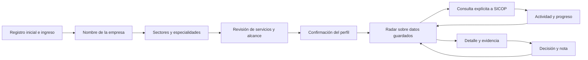

# NexoLicitCR: de lo que tu empresa sabe hacer a lo que merece revisar

> **Automatizamos la búsqueda. Tu PYME construye el futuro.**
>
> Una empresa tiene experiencia, servicios y capacidad de respuesta. NexoLicitCR convierte esa identidad comercial en un punto de partida para explorar concursos públicos de Costa Rica, entender las coincidencias y conservar las decisiones.

Este capítulo describe el comportamiento disponible en la rama `dev`, revisión `4c91af4`, documentada el 18 de octubre de 2026. Combina presentación de producto, guía de uso y guion de demostración. Los personajes y empresas usados como ejemplos son hipotéticos. Las mejoras futuras se identifican expresamente como propuestas; las pruebas del repositorio no constituyen validación comercial con clientes.

## 1. La idea que vale la pena contar

Imaginemos una PYME capaz de instalar redes de datos, desarrollar aplicaciones y dar soporte a equipos. Su problema comercial no termina al definir qué vende: también necesita identificar dónde tiene sentido invertir tiempo en preparar una oferta. Cada expediente trae títulos, líneas, fechas, condiciones y anexos. La pregunta práctica es sencilla: **«¿Cuál de estas oportunidades merece que mi empresa se siente a revisarla?»**

NexoLicitCR organiza ese primer trabajo. La empresa define su actividad, revisa los servicios que quiere buscar y consulta una selección de concursos públicos de SICOP. El radar muestra afinidad, explica las coincidencias y permite abrir la evidencia. La empresa mantiene el criterio final y registra qué seguirá, qué descartará y qué necesita revisar.

El valor de la propuesta está en conectar tres elementos que juntos resultan más útiles que una lista de publicaciones:

1. **Identidad comercial:** qué ofrece la empresa y cuáles son sus límites.
2. **Contexto verificable:** qué dice el concurso y dónde aparece la coincidencia.
3. **Continuidad de trabajo:** qué decidió la empresa y qué consultas quedan pendientes.

La promesa defendible es ofrecer una forma más ordenada y explicable de preparar la revisión de oportunidades. El proyecto todavía no aporta mediciones de ahorro de tiempo, conversión comercial o adjudicaciones atribuibles al sistema.

### Presentación breve

> «NexoLicitCR empieza por tu empresa. Nos contás qué ofrecés, confirmás tus servicios y abrís un radar de concursos con coincidencias explicadas. Podés revisar la fuente, guardar una decisión y retomar el trabajo después. La información pública se convierte en una lista de opciones con contexto para tu próximo paso comercial».

### Presentación para una defensa de proyecto

> «Diseñamos una aplicación que une perfil empresarial, ingesta de concursos SICOP, evidencia documental y seguimiento. La experiencia empieza con decisiones sencillas para la PYME; debajo, una base documental y trabajos persistentes permiten conservar información, versiones y avances. Su aporte es hacer visible el vínculo entre la capacidad de una empresa y el contenido de un expediente, incluyendo lo que todavía falta comprobar».

## 2. El problema, visto desde la empresa

El escenario de diseño es una empresa con recursos de revisión limitados. No se afirma que todas las PYMES enfrenten exactamente las mismas dificultades ni que se haya realizado un estudio representativo. Las siguientes situaciones explican las decisiones del producto y sirven como hipótesis para una evaluación posterior.

| Situación de trabajo | Fricción que intenta resolver NexoLicitCR | Respuesta presente en el producto |
|---|---|---|
| La empresa ofrece varias actividades | Una única etiqueta puede describir mal sus capacidades | Selección de hasta ocho especialidades, incluso de sectores distintos |
| El usuario conoce su negocio, pero no una taxonomía técnica | Traducir la actividad a términos de búsqueda exige un primer esfuerzo | Servicios sugeridos, editables y sujetos a confirmación |
| Una publicación tiene un título general | La relación con el negocio puede estar en las líneas o los anexos | Comparación con título, líneas y texto documental disponible |
| Hay una coincidencia, pero se desconoce su causa | Un número aislado dificulta evaluar el resultado | Razones por término o código y fragmentos de evidencia |
| Una consulta tarda o se interrumpe | Cerrar la pantalla puede generar incertidumbre sobre lo procesado | Actividad persistente, estados visibles y reanudación de pendientes |
| El perfil comercial cambia | Sería costoso reconstruir decisiones anteriores | Seguimiento independiente del cálculo de afinidad |
| Un anexo no se pudo leer por completo | El usuario podría asumir una revisión completa | Estados documentales, errores y afinidad preliminar explícitos |

Estas respuestas reducen pasos de organización y lectura repetitiva en el flujo diseñado. La magnitud del beneficio debe medirse con usuarios y tareas comparables antes de expresarla como un porcentaje o una cantidad de horas ahorradas.

## 3. A quién le puede servir

### Persona A: la dueña que también vende

**Ejemplo hipotético: Laura, responsable de una pequeña empresa de servicios informáticos.** Coordina entregas y también busca clientes. Quiere iniciar una revisión con los servicios reales de la empresa y comprender por qué aparece cada concurso.

Su recorrido central sería configurar la empresa, elegir redes informáticas y software, corregir los términos sugeridos, consultar novedades y abrir los expedientes que merezcan atención. Una señal útil para ella sería poder explicar una coincidencia con el fragmento que la originó.

### Persona B: el coordinador de una empresa con varias especialidades

**Ejemplo hipotético: Andrés, responsable comercial de una empresa de mantenimiento e instalaciones.** La empresa realiza trabajos eléctricos, mantenimiento de edificios y climatización. Necesita expresar esas capacidades juntas sin asumir que ofrece todas las actividades de un sector.

La selección múltiple permite construir ese perfil. El catálogo manual puede complementar la descripción con productos o servicios concretos. El radar calcula afinidad usando los términos confirmados y los ítems activos del catálogo.

### Persona C: la persona encargada de preparar una revisión

**Ejemplo hipotético: Daniela, asistente administrativa de una PYME.** Su tarea es reunir contexto para que otra persona decida si estudiar un concurso. Le interesa registrar una nota sobre requisitos pendientes y volver a los documentos consultados.

La aplicación ofrece una nota por decisión y enlaces a la evidencia y al expediente original. El modelo actual tiene una cuenta administrativa por instalación y un perfil de empresa; este ejemplo describe un rol de trabajo, no una funcionalidad de usuarios múltiples, asignación de responsables o colaboración simultánea con permisos diferenciados.

### Casos de uso concretos

| Caso hipotético | Acción | Resultado observable |
|---|---|---|
| Empresa de software y soporte | Confirma ambas especialidades y revisa el radar | Las coincidencias usan los servicios confirmados de ambas actividades |
| Contratista de edificios y obra vial | Combina especialidades de construcción | El borrador reúne términos sin limitarse a una sola especialidad |
| Empresa de redes deportivas | Selecciona redes para arcos y porterías | La sugerencia distingue esa actividad de redes informáticas y redes sociales |
| Proveedor de insumos y servicios | Conserva el tipo de concurso en «Todos» | La consulta puede recorrer bienes, servicios y obras dentro del alcance seleccionado |
| Empresa que amplía su oferta | Edita el perfil y confirma la revisión | Se recalcula afinidad mientras se conservan las decisiones existentes |
| Persona que retoma una consulta interrumpida | Abre Actividad y reanuda los pendientes | Se aprovecha el avance conservado y se mantiene el alcance original |

## 4. El recorrido completo

El recorrido separa dos decisiones del usuario: **confirmar cómo se describe la empresa** y **solicitar una consulta de SICOP**. Guardar un perfil no crea una sincronización. Esto permite revisar la identidad comercial antes de consumir una consulta externa.

### 4.1 Registro inicial: crear el acceso de la instalación

En una instalación nueva, la página inicial muestra el formulario de registro. Se eligen nombre de usuario y contraseña; después se inicia sesión. La contraseña admitida tiene entre 14 y 256 caracteres y se solicita confirmación.

El registro se cierra cuando ya existe la primera cuenta, incluso si posteriormente se desactiva. El formulario no agrega más administradores ni restablece credenciales. Este comportamiento corresponde a una instalación de una empresa; no representa un portal abierto para registrar muchas empresas independientes.

El arranque no crea empresas, productos o concursos ficticios. Una instalación vacía empieza con datos vacíos y guía al usuario hacia la configuración.

Referencia: [registro y sus pruebas](../../tests/test_registration.py), [plantilla de registro](../../src/nexolicitcr/templates/register.html) e [instalación](../../README.md#instalación).

### 4.2 Mi empresa: empezar por un nombre reconocible

La pantalla `/company` pregunta el nombre comercial. No solicita cédula jurídica ni documentos para completar ese paso. El nombre ayuda a presentar el espacio de trabajo con la identidad de la empresa.

Continuar produce un borrador. La información del perfil se guarda al confirmar el último paso. Esto permite explorar y corregir la configuración antes de sustituir el perfil confirmado.

Referencia: [pantalla de empresa](../../src/nexolicitcr/templates/company.html) y [pruebas de onboarding](../../tests/test_onboarding.py).

### 4.3 Sectores: encontrar un punto de partida

La selección guiada incluye **20 sectores y 66 opciones de especialidad**. Son opciones comerciales mantenidas por el proyecto; no constituyen una clasificación oficial SICOP, CIIU ni una acreditación de la empresa.

Entre los sectores se incluyen tecnología, construcción, limpieza, alimentación, mobiliario, salud, transporte, educación, consultoría, ambiente y actividades agropecuarias. También existe una opción para describir otra actividad.

El selector de sector filtra lo que se ve. Cambiarlo conserva las especialidades seleccionadas. Esta distinción permite explorar varios sectores sin perder el borrador de capacidades.

Referencia: [taxonomía completa](../taxonomy.md) y [vocabulario implementado](../../src/nexolicitcr/sectors.py).

### 4.4 Especialidades múltiples: describir una empresa real

Se pueden seleccionar hasta **ocho especialidades**, incluyendo combinaciones de diferentes sectores. Una empresa puede, por ejemplo, combinar software, redes informáticas e instalaciones eléctricas si esas actividades representan lo que realmente ofrece.

Para especialidades conocidas, la descripción libre es opcional: el servidor construye una frase explícita con la selección. «Otra actividad» exige una descripción con al menos 12 caracteres, incluso si se combina con una especialidad conocida.

Los términos de las especialidades se reúnen sin duplicados. El borrador sigue siendo editable. La selección no declara que la empresa tenga certificaciones, capacidad financiera, experiencia contractual o disponibilidad para ejecutar un contrato.

El perfil admite hasta ocho servicios por cada especialidad seleccionada, con un máximo de 64 servicios para ocho especialidades. El límite se aplica al total permitido según la selección; los términos se presentan y editan como una lista de servicios.

Referencia: [contrato del perfil](../../src/nexolicitcr/models.py), [interfaz de descubrimiento](../../src/nexolicitcr/templates/discover.html) y [pruebas de múltiples especialidades](../../tests/test_multi_specialties.py).

### 4.5 Revisión: convertir sugerencias en una decisión de la empresa

La pantalla final muestra el nombre, las especialidades y los servicios propuestos. El usuario puede quitar servicios, editar términos y abrir ajustes adicionales.

| Dato | Para qué sirve | Cómo interpretarlo |
|---|---|---|
| Actividad | Describe la empresa en una frase | Texto confirmado por la empresa |
| Productos o servicios | Define términos que usa la comparación | Deben corresponder con capacidades reales |
| Cobertura | Conserva dónde puede atender | Referencia informativa; no filtra automáticamente la ubicación del concurso |
| Exclusiones | Identifica términos que pueden invalidar una coincidencia de un ítem | Conviene usar términos específicos y revisar su efecto |
| Tipo de concurso | Define el rubro para futuras consultas del perfil | Todos, bienes, servicios u obras |

Volver a la selección conserva los ajustes del borrador mediante un formulario de revisión. Confirmar guarda el perfil y abre el radar. Si otra edición ha cambiado la revisión del catálogo, el sistema detecta el conflicto para evitar sobrescribir silenciosamente la versión más reciente.

Las sugerencias son deterministas. No se envía la actividad a un proveedor externo de modelos de lenguaje para producir el perfil. El vocabulario reconoce actividades y algunas variantes explícitas; una descripción desconocida puede necesitar servicios escritos manualmente.

### 4.6 El catálogo manual: más detalle cuando hace falta

El perfil guiado convive con `/catalog`. Cada ítem permite guardar nombre, descripción, capacidades, cobertura, palabras clave, exclusiones y, opcionalmente, sistema y código de clasificación. Un ítem puede estar activo o inactivo.

El radar combina los servicios del perfil confirmado con los ítems activos del catálogo. En la comparación actual, las palabras clave del ítem —o su nombre cuando no tiene palabras clave— aportan términos de búsqueda. La descripción, capacidades y cobertura documentan el ítem, pero no forman un análisis semántico automático de toda la ficha.

Sistema y código deben indicarse juntos. La coincidencia por código utiliza códigos exactamente iguales con sistema `SICOP`; introducir una clasificación diferente no la transforma en un equivalente SICOP.

Referencia: [catálogo](../../src/nexolicitcr/templates/catalog.html), [modelos](../../src/nexolicitcr/models.py) y [reglas de comparación](../../src/nexolicitcr/matching.py).

### 4.7 Mi radar: una lista con razones

El radar `/opportunities` muestra resultados sobre los concursos guardados en la instalación. El perfil comercial sirve para evaluarlos; el radar no representa todos los concursos de SICOP.

Cada tarjeta presenta título, institución, tipo de concurso, procedimiento, afinidad, cierre informado y estado. Cuando existe una coincidencia, muestra una razón breve, por ejemplo que un término aparece en el título o en la información del concurso. Si falta evidencia documental completa, lo señala.

Los filtros permiten buscar por título o institución, elegir una vista, filtrar bienes/servicios/obras y ajustar la afinidad mínima. La búsqueda textual normaliza mayúsculas y tildes. El filtro de tipo sobre el corpus guardado no cambia el perfil comercial ni el alcance de una consulta futura.

Con perfil confirmado, «Por revisar» usa por defecto una afinidad mínima de 1. Ajustarla a 0 permite explorar también registros sin coincidencias. La vista «Por revisar» excluye concursos cerrados, cancelados y decisiones descartadas; no equivale exclusivamente a la decisión individual «Por revisar»: puede incluir resultados marcados como relevantes o en seguimiento.

El radar muestra 25 resultados por página. Los filtros se conservan al navegar entre páginas.

### 4.8 Consultar SICOP: elegir el alcance con claridad

El radar ofrece consultas rápidas, equilibradas, ampliadas o extensas: **10, 25, 50 o 100 concursos recientes por rubro confirmado**. Además, se revisan hasta esa cantidad de concursos activos ya guardados por rubro. Por ello, el valor seleccionado no debe presentarse como un total absoluto de todo el trabajo.

La opción para revisar anexos y aplicar OCR cuando haga falta aparece seleccionada en el radar. Puede desmarcarse: en ese caso, la afinidad usa título, líneas y los anexos que ya estén disponibles. Procesar documentos puede aumentar la duración y puede dejar evidencia parcial si se alcanzan límites o falla la extracción.

La consulta queda en una cola persistente. El usuario puede salir de la pantalla y consultar el avance en Actividad. Para que el trabajo progrese, el worker y sus dependencias deben estar disponibles; el cierre del navegador no mantiene por sí solo un servidor apagado.

Desde Sincronizaciones también existe un formulario general con rubro, límite entre 1 y 500, fecha inicial opcional y procesamiento de anexos. Esta es una forma de ampliar la consulta sin alterar el perfil confirmado.

Referencia: [radar](../../src/nexolicitcr/templates/opportunities.html), [sincronizaciones](../../src/nexolicitcr/templates/jobs.html), [filtros de consulta](../../tests/test_discovery_filters.py) y [operación](../operations.md).

### 4.9 Abrir un concurso: pasar de la señal a la revisión

El detalle reúne las líneas solicitadas, sus cantidades y unidades conocidas, precios presupuestados, condiciones disponibles, fecha de cierre, última observación y enlace al expediente SICOP.

La lectura sugerida es:

1. Confirmar que el objeto del concurso corresponde con la actividad real de la empresa.
2. Revisar la vigencia y la fecha de cierre, incluyendo cualquier dato pendiente de interpretación.
3. Comparar las líneas solicitadas con lo que la empresa puede entregar.
4. Consultar las condiciones disponibles y los anexos.
5. Abrir el expediente original para verificar los requisitos completos antes de decidir cómo continuar.

Los importes de las líneas están etiquetados como **presupuestados**. El histórico disponible corresponde a **ofertas presentadas**; no acredita adjudicación ni precio unitario. Los comparables adjudicados permanecen pendientes de una fuente final validada.

Referencia: [detalle del concurso](../../src/nexolicitcr/templates/tender.html) y [contratos Tender, Offer y Award](../../src/nexolicitcr/models.py).

### 4.10 Evidencia: entender de dónde viene una coincidencia

El detalle de afinidad expone términos o códigos, método de origen y fragmentos. Cuando la razón proviene de un documento, ofrece un enlace a su página extraída. Los fragmentos se toman del texto disponible, conservando una conexión revisable con la fuente.

La vista documental muestra páginas, método de extracción, versión del extractor y errores si los hay. Puede mostrar texto digital, texto reconocido mediante OCR o contenido no disponible. Si existe el archivo guardado, permite descargar el original.

Una página ilegible, un límite de páginas o la falta de una dependencia de OCR no significa que el documento carezca de requisitos. La aplicación conserva esos estados para que la revisión pueda continuar con el original.

Referencia: [vista documental](../../src/nexolicitcr/templates/document.html), [pruebas documentales](../../tests/test_documents_history.py) y [calidad OCR](../../tests/test_ocr_quality.py).

### 4.11 Decisión: conservar el criterio de la empresa

Cada concurso permite registrar una decisión y una nota privada de hasta 2.000 caracteres.

| Decisión | Uso propuesto para organizar el trabajo |
|---|---|
| Por revisar | Todavía falta evaluar el expediente |
| Relevante | El contenido merece atención para la empresa |
| En seguimiento | Se mantiene en la lista de trabajo activa |
| Descartado | La empresa decide apartarlo de la revisión principal |

La interpretación comercial de cada estado la define la empresa. La aplicación no inicia la presentación de una oferta, no solicita una aprobación de otro usuario y no adjudica una tarea al guardar una decisión.

Una nota útil expresa un pendiente concreto: «Revisar capacidad de atención en la ubicación indicada y confirmar características de la línea 2». Modificar el perfil o recalcular afinidad conserva la decisión. El feedback no reescribe automáticamente los servicios ni las exclusiones.

Referencia: [persistencia de decisiones al cambiar el perfil](../../tests/test_discovery.py) y [decisiones independientes de caché](../../tests/test_cache_matching.py).

## 5. Cómo leer los estados sin perder contexto

La interfaz combina estado del concurso, estado de la consulta y decisión de la empresa. Cada uno responde una pregunta distinta.

### Estado del concurso: qué se conoce de su vigencia

| Estado visible | Interpretación en la aplicación |
|---|---|
| Abierto | Estado abierto con cierre interpretable todavía futuro |
| Publicado | Estado publicado con cierre interpretable todavía futuro; se conserva la distinción de la fuente |
| Cerrado | La fuente indica cierre o la fecha interpretable ya venció |
| Cancelado | La fuente indica cancelación |
| Fecha por confirmar | Falta una fecha de cierre interpretable o el estado no permite una conclusión más precisa |

El sistema conserva la fecha original y, cuando existe, su interpretación temporal. Una fecha desconocida no se transforma en certeza de apertura. La vista «Fecha desconocida» ayuda a encontrar estos casos para revisarlos.

### Estado de la consulta: qué está ocurriendo con la actualización

| Estado visible | Qué significa | Próximo paso razonable |
|---|---|---|
| En cola | La solicitud está persistida y espera ejecución | Revisar disponibilidad del worker si la espera se prolonga |
| Consultando | El worker está procesando la consulta | Consultar progreso o continuar otra tarea |
| Reintento pendiente | Hubo una interrupción y existe un intento programado | Revisar el momento del siguiente intento |
| Completada | El trabajo terminó su alcance de procesamiento | Abrir el radar y revisar resultados |
| No completada | Se agotaron intentos o quedó un error terminal | Leer el motivo y usar «Reanudar pendientes» cuando corresponda |
| Cancelada | Se detuvo la consulta solicitada | Mantener lo procesado o reanudar pendientes |

«Completada» no acredita cobertura total del mercado ni lectura perfecta de todos los documentos. El detalle documental mantiene sus propios estados. «No completada» tampoco equivale a cero resultados: los concursos procesados permanecen en el espacio.

El sistema puede pausar nuevas consultas cuando SICOP limita la frecuencia. La interfaz muestra esa situación y permite revisar lo ya guardado. La cancelación se solicita y se aplica al terminar el paso actual. La reanudación conserva el alcance y los checkpoints del trabajo anterior y comprueba de nuevo la ventana reciente.

Referencia: [detalle de actividad](../../src/nexolicitcr/templates/job.html), [pruebas de trabajos](../../tests/test_jobs.py) y [recuperación del worker](../../tests/test_worker_recovery_integration.py).

### Cuando el radar está vacío

Un radar vacío requiere interpretación, no una conclusión comercial automática:

- **Primera consulta pendiente:** el perfil está confirmado, pero aún no se consultó SICOP.
- **Sin información guardada:** conviene revisar la actividad de la consulta y su resultado.
- **Sin coincidencias con los filtros:** puede haber concursos guardados que no cumplen el filtro; afinidad mínima 0 ayuda a explorarlos.
- **Actualización interrumpida:** puede haber datos parciales y pendientes por recuperar.

Ninguno de estos casos demuestra que no existan oportunidades en SICOP. La consulta tiene un alcance acotado.

## 6. Qué significa la afinidad

La afinidad es un puntaje de relevancia orientativa entre 0 y 100. Su función es priorizar lectura. No expresa probabilidad de ganar, cumplimiento de requisitos, rentabilidad ni elegibilidad.

Las reglas actuales suman evidencia por término y método, con topes y deduplicación. Una coincidencia en título aporta 35 puntos; en líneas, 30; en texto documental, 15; un código SICOP exacto, 40. El resultado de cada ítem se limita a 100 y el concurso toma el mayor puntaje entre los ítems evaluados. Por tanto, el número no debe interpretarse como porcentaje de requisitos cubiertos.

Una exclusión encontrada en título, líneas o texto digital anula el puntaje del ítem afectado. Cuando aparece solo en OCR, se marca para revisión humana. Como el concurso toma el máximo entre ítems, una exclusión de un ítem no necesariamente elimina las coincidencias de otros ítems del catálogo.

El motor normaliza tildes y mayúsculas, contempla variantes explícitas de singular y plural y aplica ciertos alias de obras dentro del rubro correspondiente. No comprende cualquier sinónimo o negación compleja. Por ejemplo, compartir la palabra «ciberseguridad» puede conectar un curso con un servicio de consultoría, aunque la empresa solo ofrezca uno de ellos.

La etiqueta preliminar aparece cuando falta evidencia documental, no hay páginas disponibles o hay errores en ellas. La ausencia de esa etiqueta tampoco prueba que el expediente esté íntegramente evaluado: el modelo conserva `requirements_complete=False`.

Una forma clara de presentarlo es: **«Este número te ayuda a decidir qué leer primero. Las razones te ayudan a comprobar si vale la pena seguir»**.

Referencia: [matching.py](../../src/nexolicitcr/matching.py), [regresiones de búsqueda](../../tests/test_search_regressions.py) y [validación del modelo de concurso](../../src/nexolicitcr/models.py).

## 7. Demostración guiada: de una empresa a una decisión

El siguiente guion está pensado para una exposición del proyecto. La empresa «Nexo Taller Digital» y la persona responsable son **hipotéticas**. El nombre se propone para la demostración, no como cliente del producto.

### Preparación

Usar una instalación de demostración propia. Verificar acceso, worker y conexión a su base de datos siguiendo la [guía de operación](../operations.md). Para mostrar evidencia sin depender del tiempo de respuesta de SICOP, se puede preparar una consulta real acotada y conservar su fecha de observación; su vigencia debe revisarse al exponerla.

Las pruebas sintéticas del repositorio sirven para validar comportamiento de manera aislada. No deben mezclarse con el corpus real ni presentarse como contrataciones existentes. No hace falta provocar una consulta fallida para explicar el estado de error: se puede mostrar la tabla de estados o una captura claramente identificada de un entorno de pruebas.

### Escena 1: «Empecemos por lo que sabés hacer»

Abrir Mi empresa e introducir el nombre hipotético. Explicar que el registro y el nombre comercial resuelven acceso e identidad; aún no se consultó SICOP.

**Mensaje al público:** «La empresa comienza describiéndose con su propio lenguaje. Primero construimos una base de búsqueda que pueda reconocer y corregir».

### Escena 2: «Una PYME puede tener más de una capacidad»

Elegir «Tecnología e informática» y seleccionar «Redes informáticas y cableado» y «Software y aplicaciones». Si se desea mostrar combinación entre sectores, agregar una especialidad que pertenezca de verdad al escenario hipotético y explicar por qué.

Cambiar el filtro de sector y volver para mostrar que las selecciones se conservan. El objetivo de la escena es enseñar flexibilidad, no llenar el perfil con actividades que la empresa no ofrece.

**Mensaje al público:** «El perfil puede representar una empresa que combina capacidades. Cada selección se convierte en servicios que podemos revisar antes de confirmar».

### Escena 3: «La última palabra la tiene la empresa»

Abrir el borrador, leer las sugerencias y editar un servicio. Añadir una cobertura como referencia, explicando que todavía debe verificarse la ubicación de cada expediente. Si se usa una exclusión, elegir un término específico y señalar su efecto sobre el puntaje.

Confirmar y mostrar que se abre el radar. La primera consulta sigue siendo una acción explícita.

**Mensaje al público:** «El sistema propone; la empresa confirma. Así evitamos convertir una sugerencia en una capacidad que nadie declaró».

### Escena 4: «El alcance también se decide»

Elegir una consulta acotada del radar. Mostrar el selector de volumen, el rubro que deriva del perfil y la opción de anexos. Al iniciarla, abrir Actividad.

Si SICOP demora o solicita una pausa, explicar el estado observado. No cambiar el relato para insinuar que el trabajo terminó. Se puede seguir la demostración con concursos ya guardados y presentar su fecha de observación.

**Mensaje al público:** «La consulta tiene un alcance visible y conserva su avance. Podemos continuar trabajando mientras llegan los datos disponibles».

### Escena 5: «Una coincidencia tiene que explicar su presencia»

Elegir un resultado real disponible que permita mostrar una razón clara. Abrir el detalle, señalar el término y su fragmento. Si hay evidencia documental, navegar a la página extraída y mostrar el método. Si faltan documentos, mostrar el estado pendiente como parte real del producto.

**Mensaje al público:** «Aquí está el término que relaciona el concurso con la empresa, y aquí podemos revisar el contexto. La afinidad ordena; la evidencia permite discutir la decisión».

### Escena 6: «La revisión deja memoria»

Guardar la decisión «En seguimiento» y una nota concreta. Regresar al radar y abrir la vista de seguimiento. Explicar que los cambios posteriores del perfil recalculan relevancia, mientras las decisiones permanecen guardadas.

**Mensaje al público:** «El valor continúa después de encontrar una publicación: queda registrado qué merece atención y qué falta revisar».

### Cierre sugerido

> «NexoLicitCR conecta la identidad de una empresa con información pública que puede revisar y discutir. Hoy entrega un recorrido completo: perfil, consulta, razones, evidencia y seguimiento. El siguiente paso es evaluar esa experiencia con empresas y medir cuánto ayuda a tomar mejores decisiones de revisión».

## 8. Diferenciadores que se pueden demostrar

| Rasgo | Cómo se demuestra | Valor esperado |
|---|---|---|
| Configuración por actividad comercial | Empresa → especialidades → servicios confirmados | Un inicio comprensible para quien conoce su negocio |
| Múltiples especialidades | Selección entre sectores y borrador combinado | Representar capacidades diversas en el mismo perfil |
| Razones visibles | Término, origen y fragmento en el detalle | Hacer discutible y revisable una coincidencia |
| Incertidumbre visible | Fecha desconocida, anexos pendientes y evidencia preliminar | Evitar conclusiones que la información disponible no permite |
| Trabajo persistente | Cerrar la vista y volver a Actividad | Continuidad de consultas con infraestructura en funcionamiento |
| Decisión independiente | Cambiar el perfil y conservar el seguimiento | Memoria de la revisión comercial |
| Fuentes accesibles | Abrir expediente SICOP y documento original disponible | Volver a la información de origen |
| Catálogo y perfil combinados | Ítems activos junto a servicios confirmados | Incorporar detalle progresivamente |

Estos son rasgos verificables del repositorio. No constituyen una comparación exhaustiva con productos comerciales ni una afirmación de exclusividad en el mercado.

## 9. Alcance actual y fronteras del producto

La versión actual es una aplicación de apoyo a descubrimiento y revisión de concursos, con una cuenta administrativa por instalación. La siguiente tabla ayuda a presentar el proyecto con precisión.

| Disponible en el código | Límite que debe mantenerse explícito |
|---|---|
| Perfil comercial editable y confirmado | No certifica capacidades o requisitos de participación |
| Ingesta SICOP por categoría y alcance | No garantiza cobertura exhaustiva ni actualización permanente de todo SICOP |
| Matching por términos, códigos y evidencia | No realiza comprensión semántica general ni predicción de adjudicación |
| Extracción digital y OCR | Puede quedar parcial; requiere dependencias y revisión del original |
| Seguimiento y nota privada | No incluye roles, responsables múltiples ni flujos de aprobación |
| Trabajo durable y reintentos | Requiere servicios disponibles; una instalación de un nodo no demuestra alta disponibilidad |
| Histórico de ofertas presentadas | No contiene comparables adjudicados validados |
| Cobertura geográfica guardada | No actúa como filtro geográfico automático |
| Navegación y formularios adaptables | No se afirma auditoría integral de accesibilidad ni equivalencia con una aplicación móvil nativa |
| Inicio desde datos vacíos | No hay resultados comerciales garantizados al crear el perfil |

La aplicación no presenta ofertas en SICOP, no toma decisiones legales de elegibilidad y no envía alertas comerciales automáticas por correo o mensajería en este flujo. Esas capacidades no forman parte del recorrido implementado descrito aquí.

## 10. Evolución propuesta: crecer sobre una base comprobable

Las siguientes ideas son **propuestas de producto**. No se presentan como funcionalidades terminadas ni como compromisos de fecha.

### Propuesta A: evaluación con tareas reales de revisión

Invitar a empresas a configurar un perfil, revisar un conjunto de concursos y explicar por qué consideran relevante o irrelevante cada resultado. Usar pares etiquetados por personas para observar falsos positivos, oportunidades omitidas y dificultades de comprensión.

Una evaluación útil mediría tiempo hasta la primera decisión fundamentada, proporción de resultados considerados útiles, errores al interpretar el puntaje y pasos necesarios para corregir un perfil. Se deben registrar condiciones de la prueba, tamaño de muestra y criterios de selección; el repositorio no aporta todavía esas mediciones comerciales.

### Propuesta B: ajustes sugeridos desde el feedback

Convertir decisiones y motivos en propuestas de cambios al perfil. Por ejemplo, sugerir un término más específico cuando se descarten repetidamente resultados ambiguos. Cada ajuste debería mostrar su fundamento y requerir confirmación antes de modificar servicios o exclusiones.

La decisión actual se conserva, pero todavía no existe ese ciclo automático de sugerencias.

### Propuesta C: alertas y recordatorios configurables

Explorar notificaciones de novedades o cierres próximos con consentimiento, frecuencia elegida y controles para evitar duplicados. Antes de incorporarlas, definir canales, datos necesarios, tratamiento de fechas desconocidas y comportamiento ante fallos de actualización.

Esta propuesta ampliaría el seguimiento; no describe un servicio de alertas ya operando.

### Propuesta D: colaboración de equipos

Evaluar usuarios múltiples, roles, asignación de responsables y registro de cambios. Requeriría ampliar el modelo de acceso y aislamiento, porque hoy el producto está organizado alrededor de un administrador y una empresa por instalación.

### Propuesta E: comparables adjudicados con fuente validada

Incorporar comparables únicamente después de confirmar una fuente de adjudicación final, identificación por línea, unidad y moneda. El modelo `Award` reserva un contrato posible, pero no hay un importador que complete esa capacidad ni deben inferirse adjudicaciones desde ofertas presentadas.

### Propuesta F: mejoras de búsqueda guiadas por evidencia

Ampliar vocabulario y variantes a partir de casos etiquetados, documentar regresiones y revisar el efecto en precisión y cobertura. Una incorporación futura de modelos de lenguaje exigiría evaluar proveedor, coste, privacidad y fiabilidad; las reglas deterministas actuales permiten entregar el flujo sin esa dependencia.

## 11. Mapa de fuentes para revisar este capítulo

| Tema | Fuente del repositorio |
|---|---|
| Propósito y arranque | [README](../../README.md) |
| Diseño del descubrimiento | [Descubrimiento guiado](../guided-discovery.md) |
| Taxonomía comercial | [Taxonomía](../taxonomy.md) y [sectors.py](../../src/nexolicitcr/sectors.py) |
| Sugerencias y catálogo combinado | [discovery.py](../../src/nexolicitcr/discovery.py) |
| Contratos y límites | [models.py](../../src/nexolicitcr/models.py) |
| Relevancia y evidencia | [matching.py](../../src/nexolicitcr/matching.py) |
| Formularios y rutas | [web.py](../../src/nexolicitcr/web.py) y [plantillas](../../src/nexolicitcr/templates/) |
| Registro inicial | [test_registration.py](../../tests/test_registration.py) |
| Selección múltiple y conservación de borradores | [test_multi_specialties.py](../../tests/test_multi_specialties.py) |
| Perfil, radar y decisiones | [test_discovery.py](../../tests/test_discovery.py) y [test_web.py](../../tests/test_web.py) |
| Alcance y filtros | [test_discovery_filters.py](../../tests/test_discovery_filters.py) |
| Términos ambiguos y regresiones | [test_sectors.py](../../tests/test_sectors.py) y [test_search_regressions.py](../../tests/test_search_regressions.py) |
| Operación y recuperación | [Operación](../operations.md) y [test_jobs.py](../../tests/test_jobs.py) |

Este mapa permite comprobar cada afirmación de funcionamiento contra sus contratos, pantallas y pruebas. La propuesta comercial puede crecer con la evidencia: primero una experiencia comprensible, después una evaluación con empresas y, a partir de sus resultados, decisiones sobre la siguiente etapa del producto.
