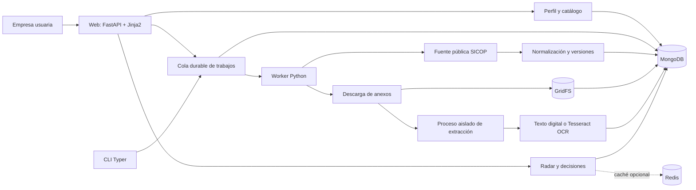
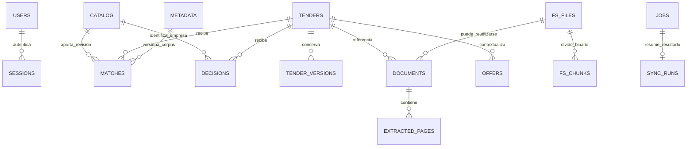
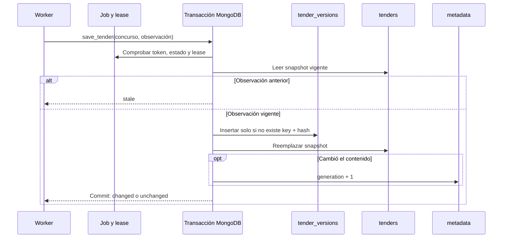
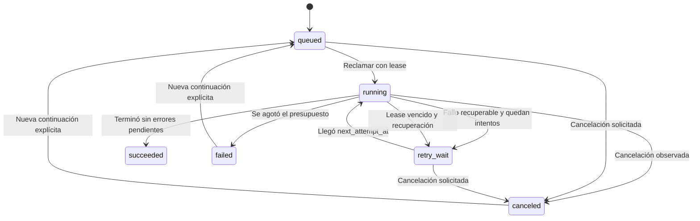

# Arquitectura y datos: confianza que se puede explicar

> **La oportunidad comercial empieza en la información; la confianza empieza en poder demostrar de dónde salió.** NexoLicitCR conecta el perfil de una empresa con concursos públicos y conserva la evidencia que permite revisar cada coincidencia.

Esta guía describe la implementación de la rama `dev`, revisada sobre el commit `4c91af4`, con fecha editorial del 18 de octubre de 2026. Su objetivo es servir a desarrolladores, evaluadores de Bases de Datos Avanzadas y personas que necesiten entender qué respalda técnicamente la propuesta. Las funciones indicadas como implementadas se apoyan en los archivos enlazados; las posibles mejoras se identifican como evolución futura.

La propuesta técnica combina un backend modular en Python, MongoDB como persistencia principal, documentos en GridFS, un worker con trabajos recuperables y Redis opcional para acelerar el radar. La afinidad se calcula mediante reglas explícitas y versionadas. Las sugerencias del perfil también son deterministas: no hay un modelo generativo ni un clasificador entrenado tomando decisiones comerciales.

**Actualización de integridad GridFS:** las cargas nuevas usan identificadores independientes para evitar conflictos entre fragmentos de escritores concurrentes; `metadata.sha256` tiene índice para reutilizar archivos completos verificados. Se admiten blobs históricos identificados por hash. El estado listo exige verificar contenido y tamaño; un reintento repara referencias incompletas sin borrar fragmentos activos. Radar y detalle comparten el cálculo de evidencia pendiente.

## 1. La arquitectura en una página

El sistema permite que una empresa defina lo que ofrece, consulte concursos de SICOP, incorpore evidencia documental y ordene sus oportunidades por afinidad. Las decisiones de seguimiento pertenecen a la empresa y se conservan independientemente de los recálculos.



La aplicación es un **monolito modular con procesos de ejecución separados**. La web y el worker comparten contratos y servicios del mismo paquete. Esta organización reduce la complejidad operativa de un proyecto pequeño y mantiene la consulta HTTP separada del trabajo costoso de descargar, procesar y extraer documentos.

En modo local, `nexolicit api` inicia y supervisa su worker por defecto; en modo servidor, web y worker se ejecutan por separado. La persistencia no depende de la memoria de estos procesos. Detener la web no borra perfiles, sesiones, concursos ni trabajos. El siguiente worker puede recuperar un trabajo cuyo lease haya vencido.

Fuentes: [web.py](../../src/nexolicitcr/web.py), [cli.py](../../src/nexolicitcr/cli.py), [runtime.py](../../src/nexolicitcr/runtime.py), [jobs.py](../../src/nexolicitcr/jobs.py).

### 1.1 Decisiones que tienen una consecuencia visible

| Decisión técnica | Consecuencia para la empresa | Tema de Bases de Datos Avanzadas |
|---|---|---|
| MongoDB conserva estado y evidencia normalizada | La información sobrevive a reinicios y se puede volver a consultar | Persistencia documental y diseño de agregados |
| Snapshot actual más versiones históricas | Un cambio de la fuente no destruye el registro anterior | Versionado, trazabilidad y auditoría |
| Perfil y catálogo con revisión monotónica | Una ventana antigua no sobrescribe silenciosamente una edición reciente | Control optimista de concurrencia |
| Cola con leases, checkpoints e idempotencia | Una interrupción permite retomar el trabajo ya guardado | Coordinación distribuida y recuperación |
| Evidencia por documento y página | Cada afinidad puede mostrar un fragmento comprobable | Relaciones lógicas y procedencia |
| Redis descartable y claves versionadas | La aceleración puede fallar sin convertirse en pérdida de datos | Caché, invalidación y degradación controlada |
| Decisiones separadas de las coincidencias | Un nuevo cálculo respeta el seguimiento realizado por la persona | Separación de datos derivados y datos de negocio |

## 2. Mapa del código

| Módulo | Responsabilidad principal | Relación con el producto |
|---|---|---|
| [config.py](../../src/nexolicitcr/config.py) | Configuración tipada, secretos, límites y validación de modos | Un arranque inválido falla de forma explícita |
| [models.py](../../src/nexolicitcr/models.py) | Contratos Pydantic de catálogo, concursos, documentos, perfiles y resultados | Evita propagar datos con estructuras inesperadas |
| [storage.py](../../src/nexolicitcr/storage.py) | Conexión, índices, autenticación persistente, catálogo y concursos | Establece las reglas centrales de identidad y consistencia |
| [sicop.py](../../src/nexolicitcr/sicop.py) | Acceso a la fuente y normalización de concursos | Convierte respuestas externas en información utilizable |
| [jobs.py](../../src/nexolicitcr/jobs.py) | Encolado, reclamación, recuperación, cancelación y ejecución | Hace observables las consultas largas |
| [documents.py](../../src/nexolicitcr/documents.py) | Referencias de anexos, descarga, hash, GridFS y publicación de páginas | Conserva la evidencia detrás de una coincidencia |
| [extractor.py](../../src/nexolicitcr/extractor.py) | Extracción digital, OCR y límites del subproceso | Recupera contenido de PDF e imágenes dentro de un presupuesto |
| [matching.py](../../src/nexolicitcr/matching.py) | Normalización de términos, afinidad, explicaciones y radar | Ordena la revisión comercial de forma reproducible |
| [discovery.py](../../src/nexolicitcr/discovery.py) | Sugerencias editables y adaptación del perfil al catálogo de matching | Facilita comenzar sin conocer códigos de clasificación |
| [sectors.py](../../src/nexolicitcr/sectors.py) | Taxonomía de sectores y especialidades | Amplía la configuración guiada a distintas actividades |
| [cache.py](../../src/nexolicitcr/cache.py) | Redis opcional, claves, TTL y circuit breaker | Reduce cálculos repetidos sin asumir disponibilidad permanente |
| [history.py](../../src/nexolicitcr/history.py) | Importación y validación de ofertas presentadas | Añade contexto histórico sin inventar adjudicaciones |
| [security.py](../../src/nexolicitcr/security.py) | Usuario válido y contraseñas con Argon2 | Protege el acceso a la instalación |
| [web.py](../../src/nexolicitcr/web.py) | Sesiones, formularios, vistas, protección de origen y descargas | Expone el recorrido de uso |
| [cli.py](../../src/nexolicitcr/cli.py) | Administración, web, worker, consultas y diagnóstico | Permite operar y demostrar el sistema de forma reproducible |
| [runtime.py](../../src/nexolicitcr/runtime.py) | Supervisión del worker local | Simplifica el arranque en un equipo personal |
| [ingestion.py](../../src/nexolicitcr/ingestion.py) | Rutina directa de sincronización | Conserva una vía de ingesta en el código; el flujo operativo actual usa la cola |

La interfaz usa HTML del servidor, CSS y JavaScript nativo. No requiere una aplicación React ni una cadena de compilación npm. Los rangos de dependencias se declaran en [pyproject.toml](../../pyproject.toml) y las versiones resueltas están en [uv.lock](../../uv.lock).

## 3. Modelo documental: qué se embebe y qué se referencia

La unidad de aislamiento es una instalación con **una empresa y una base MongoDB exclusiva**. La clave `company` identifica el catálogo y aparece en coincidencias y decisiones. No existe una selección de organizaciones con autorización por tenant dentro de una misma base.

El diseño embebe los elementos que se consultan y actualizan juntos: los ítems y el perfil dentro de `catalog`, y las líneas y condiciones dentro del `payload` de un concurso. Separa los conjuntos con crecimiento o ciclo de vida diferente: versiones, anexos, páginas, resultados, decisiones y trabajos.



El diagrama representa **relaciones lógicas**. MongoDB no impone claves foráneas entre estas colecciones; la aplicación las mantiene mediante identidades, índices, transacciones y comprobaciones. La cardinalidad de `FS_FILES` permite reutilizar un mismo binario en más de una referencia documental gracias al SHA-256.

### 3.1 Diccionario de colecciones

| Colección | Identidad y campos relevantes | Finalidad y ciclo de vida |
|---|---|---|
| `users` | `_id=administrator`, `username`, `password_hash`, `active` | Cuenta administradora única de la instalación |
| `sessions` | `_id=SHA256(token)`, `user_id`, `csrf`, `expires_at` | Sesiones persistentes; vencen o se revocan al cerrar sesión |
| `login_tokens` | Hash del nonce, `expires_at`; registro usa prefijo lógico `register:` antes del hash | Formularios iniciales de un solo uso |
| `login_limits` | Hash de tipo, valor y ventana temporal; `count`, `expires_at` | Límites de intentos compartidos entre procesos |
| `catalog` | `_id=company`, `revision`, `items`, `profile`, `updated_at` | Perfil y oferta comercial revisados por la persona |
| `tenders` | `_id=source_id:sequence`, `hash`, `payload`, `observed_at`, `status`, `deadline_utc`, `source_url` | Snapshot vigente de cada concurso |
| `tender_versions` | Pareja `key`, `hash`; `payload`, `observed_at` | Contenido histórico insertado una sola vez por hash |
| `documents` | `tender_key`, `source_identity`, `sha256`, `state`, `current`, `gridfs_id`, `extractor_version` | Versión del anexo, resultado de extracción o marcador de error/omisión |
| `fs.files` | `_id` independiente por carga, nombre hash, `metadata.sha256`, tipo y metadatos GridFS | Cabecera del binario almacenado |
| `fs.chunks` | Referencia al archivo, secuencia de fragmento y contenido | Fragmentos binarios gestionados por GridFS |
| `extracted_pages` | `document_id`, `page`, `text`, `method`, `error`, `extractor_version` | Evidencia de una página concreta |
| `matches` | Empresa, revisión de catálogo, concurso, hash, reglas y generación documental | Resultado derivado con razones por producto y fecha de cálculo |
| `decisions` | `company`, `tender_key`, `status`, `note`, `updated_at` | Seguimiento humano independiente del score |
| `offers` | `tender_key`, `source_hash`, `position`, partida, precio, moneda y procedencia | Ofertas presentadas observadas en una fuente concreta |
| `jobs` | Instalación, idempotencia, payload, estado, intento, lease, checkpoints y errores | Cola durable y registro del procesamiento |
| `sync_runs` | En trabajos actuales, `_id=job_id`, estado, progreso, errores y finalización | Resumen de trabajos terminales; también admite registros de la ingesta directa |
| `metadata` | `_id=corpus`, `generation` | Versión global del corpus que participa en la caché y los resultados |

La tabla describe formas persistidas por la aplicación. Algunos marcadores de `documents` tienen `sha256` vacío y no contienen un binario: representan anexos que no pudieron descargarse o superaron el límite de archivos. El contrato `Document` valida una descarga válida; no define por sí solo todos los estados operativos de la colección.

Fuentes: [storage.py](../../src/nexolicitcr/storage.py), [documents.py](../../src/nexolicitcr/documents.py), [models.py](../../src/nexolicitcr/models.py), [jobs.py](../../src/nexolicitcr/jobs.py), [history.py](../../src/nexolicitcr/history.py).

### 3.2 Índices implementados

Además del índice único `_id` de cada colección, `Store.ensure_indexes()` declara:

| Colección | Clave del índice | Propósito |
|---|---|---|
| `users` | `username`, único | Evitar nombres de usuario duplicados |
| `sessions` | `expires_at`, TTL 0 | Eliminar sesiones vencidas de forma eventual |
| `login_tokens` | `expires_at`, TTL 0 | Limpiar nonces vencidos |
| `login_limits` | `expires_at`, TTL 0 | Limpiar contadores temporales |
| `tenders` | `status`, `deadline_utc` | Soporte de acceso por estado y fecha |
| `tenders` | `observed_at` | Acceso por antigüedad de observación |
| `tender_versions` | `key`, `hash`, único | Idempotencia del histórico |
| `sync_runs` | `started_at` | Ordenación de corridas que incluyen este campo |
| `jobs` | `installation_id`, `idempotency_key`, único | Una operación lógica por clave e instalación |
| `jobs` | `installation_id`, `status`, `next_attempt_at`, `lease_until` | Selección de trabajo pendiente o recuperable |
| `decisions` | `company`, `tender_key`, único | Una decisión vigente por concurso y empresa |
| `matches` | `company`, `catalog_revision`, `tender_key`, `tender_hash`, `rules_version`, `document_generation`, único | Identidad reproducible de cada cálculo |
| `documents` | `tender_key`, `source_identity`, `sha256`, único | Distinguir referencias y versiones de contenido |
| `documents` | `state` | Localizar estados documentales |
| `extracted_pages` | `document_id`, `page`, único | Una evidencia vigente por página de ese documento |
| `offers` | `tender_key`, `source_hash`, `position`, único | Evitar duplicar una importación del mismo HTML |

GridFS gestiona sus propios índices y estructura de archivos y fragmentos mediante el driver. El proyecto no utiliza índices de texto, índices vectoriales ni Atlas Search para el matching actual. La búsqueda textual simple de concursos usa expresiones regulares escapadas; el radar recorre los concursos para calcular afinidad cuando no hay una entrada válida en Redis.

Un índice TTL facilita limpieza, pero no constituye la verificación de acceso: `session_get()` exige `expires_at > ahora`, incluso cuando MongoDB aún no ha eliminado el documento vencido.

### 3.3 Contratos que preservan significado

Los modelos rechazan campos adicionales mediante `extra="forbid"`, recortan espacios en cadenas y no admiten números infinitos o NaN. Los importes y cantidades del concurso usan `Decimal`; al persistir el payload JSON permanecen como cadenas exactas. Esto evita introducir redondeo binario, aunque una futura agregación monetaria en MongoDB necesitaría convertir de forma explícita y controlar moneda y unidad.

Las fechas conservan el texto de origen, la fecha UTC cuando es posible determinarla y la zona horaria asumida. Una fecha no interpretable no se transforma en una fecha inventada. El estado de vencimiento puede ser `unknown` y se recalcula al responder.

El catálogo admite hasta 1.000 ítems. Cada ítem valida nombre, descripción, capacidades, cobertura, términos, exclusiones y clasificación. El perfil admite hasta 8 especialidades y hasta 8 términos por especialidad. El sistema y el código de clasificación se deben indicar juntos. Un código de otro sistema no se compara como si fuera un código SICOP.

El campo `requirements_complete` del concurso está restringido a `False`. Aunque una extracción finalice sin errores, el modelo no afirma que todos los requisitos legales o técnicos del concurso estén cubiertos.

Fuente: [models.py](../../src/nexolicitcr/models.py).

## 4. Consistencia: evitar que una buena interfaz oculte datos incoherentes

### 4.1 Catálogo con control optimista

Cada edición se envía con la revisión que vio la persona. La actualización usa el filtro `{_id: "company", revision: revisión_leída}` y aumenta `revision` en una unidad. Si otra edición ganó la carrera, el filtro deja de coincidir y se devuelve un conflicto.

Ejemplo: dos ventanas abren la revisión 7. La primera guarda la revisión 8. La segunda intenta guardar sobre 7 y recibe una indicación de recargar. De esta forma, la empresa puede editar con seguridad sin bloquear el documento durante toda la interacción.

### 4.2 Concursos: snapshot e histórico en una misma transacción

La identidad del concurso combina `source_id` y `sequence`. Su fingerprint es un SHA-256 del contenido normalizado con orden estable de claves. Se excluye `source_version`, porque un identificador de versión de la fuente no debe crear por sí solo una modificación sustantiva del concurso.

La persistencia ejecuta en una transacción:

1. Comprueba la autoridad del worker cuando existe una función de fencing.
2. Lee el snapshot actual y rechaza una observación anterior a la ya guardada.
3. Inserta la versión histórica con `$setOnInsert` si el hash todavía no existe.
4. Reemplaza el snapshot actual.
5. Incrementa `metadata.corpus.generation` únicamente si cambió el contenido.



La transacción de concursos usa `read_concern="snapshot"` y `write_concern="majority"`. La conexión también solicita escritura `majority`. Un conflicto de clave única durante la primera inserción se reintenta hasta tres veces; no existe una salida alternativa que ejecute esas escrituras sin transacción.

Esto exige un despliegue MongoDB compatible con transacciones. El modo local valida un replica set `nexo-local`; Atlas usa TLS. Un servidor MongoDB independiente sin esa capacidad no es una sustitución equivalente.

Fuente: [storage.py](../../src/nexolicitcr/storage.py), [config.py](../../src/nexolicitcr/config.py).

### 4.3 Idempotencia en distintos niveles

| Nivel | Identidad estable | Resultado de repetir |
|---|---|---|
| Alta de trabajo | Instalación + clave de idempotencia + hash de payload | Devuelve el trabajo existente; rechaza reutilizar la clave con otros filtros |
| Concurso | Clave de concurso + hash de contenido | Actualiza la observación sin multiplicar versiones iguales |
| Binario | SHA-256 como `_id` GridFS | Reutiliza un archivo idéntico ya almacenado |
| Documento | Concurso + identidad de fuente + SHA-256 | Identifica la misma versión del anexo |
| Página | Documento + número de página | Actualiza la evidencia de esa página |
| Oferta histórica | Concurso + hash de HTML + posición | No duplica filas al reimportar la misma respuesta |
| Continuación | `resume:ID_ORIGINAL` por instalación | Un reenvío devuelve la misma continuación |

La ejecución puede repetirse después de un fallo. La combinación de estas identidades y checkpoints pretende que repetir sea seguro. Esto se entiende mejor como procesamiento recuperable con efectos idempotentes que como una garantía universal de ejecución exactamente una vez.

## 5. Cola durable: el trabajo no vive dentro de una pestaña

Cada job conserva filtros, inclusión de documentos, revisión del perfil cuando corresponde, estado, número de intento, progreso, identidades terminadas, errores y tiempos de ejecución. La consulta web encola; un worker reclama y ejecuta.



Las dos últimas flechas crean **otro documento de trabajo** enlazado por `resume_of`; el original conserva su estado e historial.

### 5.1 Lease, heartbeat y fencing

Reclamar un trabajo usa `find_one_and_update`, que cambia el estado a `running`, asigna propietario y un token aleatorio, fija `lease_until` e incrementa el intento. El lease dura 90 segundos por defecto y se renueva cada tercio de ese intervalo, normalmente 30 segundos.

Las operaciones del propietario filtran por instalación, ID, estado, token, lease futuro y ausencia de cancelación. El token cambia al reclamar de nuevo. Un proceso antiguo que despierta después de perder el trabajo ya no tiene autorización para confirmar resultados.

`guard()` realiza una escritura de fencing en `jobs`. Cuando se invoca dentro de la transacción de publicación, la comprobación del lease y la modificación de datos forman parte de la misma unidad transaccional. Es una protección más fuerte que comprobar el estado una vez al comenzar una tarea larga.

### 5.2 Checkpoints después de persistir

Cada identidad completada se añade al conjunto `checkpoint`. El progreso crece solo cuando esa identidad todavía no estaba registrada. El checkpoint se guarda después de persistir el concurso y, cuando se solicitaron, procesar sus anexos.

Si el proceso cae entre guardar el concurso y guardar el checkpoint, el siguiente intento puede consultar de nuevo el registro. Las claves y versiones evitan crear duplicados del mismo contenido. Si falla un concurso, su identidad permanece pendiente y se intenta de nuevo aunque la ventana del listado reciente haya cambiado.

El límite por rubro cubre entradas recientes y revisitas de activos con presupuestos separados; también se recuperan pendientes. Por eso `limit` no equivale al número máximo absoluto de documentos modificados ni garantiza recorrer todo SICOP. La persona ve progreso procesado, que incluye actualizaciones de concursos existentes.

### 5.3 Reintentos, mantenimiento y cancelación

El presupuesto predeterminado es de tres intentos. El mantenimiento de la cola recupera leases vencidos o ausentes, resuelve cancelaciones pendientes, finaliza trabajos agotados y repara fechas de ejecución ausentes. Las reparaciones conservan checkpoints e historial y registran su acción.

La cancelación es cooperativa: se observa en los puntos de control. Una descarga o extracción en curso puede continuar hasta su siguiente comprobación o límite de tiempo. Esta semántica debe comunicarse como “cancelación solicitada”, sin prometer una interrupción instantánea de toda operación externa.

HTTP 429 en la consulta SICOP o en los metadatos documentales activa una pausa durable para toda la instalación. El worker respeta `Retry-After` y aumenta la espera mínima por intentos: 5, 10 y 20 minutos con el presupuesto predeterminado, hasta un máximo de un día. La pausa persiste aunque se reinicie el proceso o el trabajo termine agotado. El descargador de binarios trata sus respuestas HTTP no exitosas como error documental; no debe atribuirse a todas las descargas el mismo manejo especial de 429.

Fuentes: [jobs.py](../../src/nexolicitcr/jobs.py), [sicop.py](../../src/nexolicitcr/sicop.py), [documents.py](../../src/nexolicitcr/documents.py).

## 6. Evidencia documental: del archivo a una explicación verificable

### 6.1 Un recorrido con identidad y límites

El servicio obtiene las referencias de anexos desde la fuente, calcula una identidad hash a partir de ruta y nombre y solicita la URL de descarga. Los enlaces firmados son medios temporales para obtener el archivo: no se presentan como identificadores durables de la evidencia.

La descarga admite HTTPS, hosts exactos configurados, puerto 443 y direcciones DNS globales. Se rechazan credenciales en la URL, fragmentos, redirecciones inválidas y destinos no permitidos. Cada cambio de destino se vuelve a validar; se permiten como máximo cuatro iteraciones de solicitud. HTTPX no usa proxies del entorno y la descarga se realiza por bloques con un tamaño acumulado máximo.

El tipo se reconoce por firma del archivo, admitiendo PDF, PNG y JPEG. Esto evita tratar una página HTML de error como si fuera un documento válido. El SHA-256 se calcula durante la descarga y se emplea como identidad del binario GridFS.

### 6.2 Publicación documental y atomicidad real

La carga binaria a GridFS sucede **antes** de la transacción que publica las páginas y los metadatos. En la publicación se comprueba el lease, se marcan versiones anteriores de la misma referencia como no vigentes, se actualizan las páginas, se fija el estado del documento y se incrementa la generación del corpus.

También se retiran de la evidencia vigente las referencias que desaparecieron de la fuente. Esta retirada se realiza dentro de una transacción.

Hay una frontera deliberada: carga GridFS, marcadores `processing`, `failed` u `omitted` y algunas actualizaciones de generación son pasos operativos separados. No se debe describir toda la ingesta documental como una única transacción de extremo a extremo. Un corte puede dejar un binario sin referencia publicada; `document-orphans` informa archivos no referenciados con más de un día de antigüedad y no los elimina automáticamente.

### 6.3 Estados que preservan la incertidumbre

| Estado | Significado | Efecto para la revisión |
|---|---|---|
| `processing` | Existe un registro en preparación | La evidencia todavía no está publicada como lista |
| `ready` | La extracción terminó sin errores registrados en sus páginas | Se utiliza la evidencia extraída |
| `partial` | Hay páginas, errores o límites que impiden considerar completa la extracción | Las páginas disponibles pueden contribuir al score |
| `failed` | Una referencia o descarga no se pudo completar | Se conserva el motivo y la afinidad sigue siendo preliminar |
| `omitted` | El anexo superó el límite de archivos configurado | Queda explícita la parte que no se procesó |
| `current=false` | Una versión o referencia dejó de ser vigente | Se conserva, pero ya no aporta al radar actual |

`ready` describe el procesamiento dentro de las reglas y límites del extractor. No certifica comprensión íntegra del pliego ni elegibilidad de la empresa. Una página sin texto suficiente o un archivo omitido nunca equivalen a “no existen requisitos”.

### 6.4 Cuándo se aplica OCR

El extractor `pdf-ocr-v2` comienza por extraer la capa de texto con `pypdf`. Aplica OCR si hay menos de 40 caracteres o si hay menos de 250 caracteres y aparece una imagen de al menos 800 × 800 píxeles. La segunda regla permite detectar un documento escaneado que solo tiene un encabezado seleccionable.

Poppler (`pdftoppm`) convierte una página por vez a PNG, con tamaño máximo de renderizado de 2.400 píxeles. Tesseract usa el idioma español y detección automática de orientación (`spa`, `osd`, `--psm 1`). Cuando existe texto digital útil y no está incluido en el OCR, el extractor conserva ambos dentro del límite de caracteres.

Una página cuyo texto digital no se puede decodificar todavía puede pasar a OCR. Un PDF cifrado, vacío, una imagen excesiva, un modelo de idioma ausente o una salida OCR vacía dejan un error explícito. El matching puede reconocer términos separados por guion al final de línea y mantener el fragmento original para mostrar evidencia.

### 6.5 Presupuesto predeterminado de extracción

| Recurso | Límite implementado | Configuración o comportamiento |
|---|---|---|
| Tamaño por anexo | 20 MiB | `DOCUMENT_MAX_BYTES`; configurable hasta 50 MiB |
| Anexos por concurso | 5 | `DOCUMENT_MAX_FILES`; configurable de 1 a 20 |
| Páginas | 30 | `DOCUMENT_MAX_PAGES`; configurable de 1 a 100 |
| Duración total del extractor | 120 segundos | `EXTRACTION_TIMEOUT_SECONDS`; configurable de 5 a 600 |
| Texto por página | 100.000 caracteres | Recorte y validación del contrato |
| Salida JSON del extractor | 12 MiB | Verificación antes de cargar los resultados |
| Imagen de entrada | 20 millones de píxeles | Verificación mediante Pillow |
| CPU del subproceso en Unix | 110 segundos de límite suave; 115 duro | `resource.RLIMIT_CPU` |
| Archivo generado en Unix | 64 MiB | `resource.RLIMIT_FSIZE` |
| Memoria virtual en Linux | 1 GiB | `resource.RLIMIT_AS` |
| Comando nativo de renderizado/OCR | 30 segundos por invocación | Timeout de `run_command()` |

El extractor corre en otro proceso mediante una lista fija de argumentos, sin shell. En Linux se limita también memoria; en macOS se aplican los límites Unix descritos salvo memoria virtual; en Windows no existe `resource`, por lo que el límite general lo aplica el proceso padre por tiempo. Elevar el timeout configurable no elimina los límites de CPU fijados dentro del extractor en Unix.

Cuando un PDF supera el número de páginas permitido, se conservan las primeras y se marca `PAGE_COUNT_LIMIT`. Solo se procesa una página OCR a la vez por worker; aumentar workers también aumenta el consumo potencial de CPU y memoria.

Fuentes: [documents.py](../../src/nexolicitcr/documents.py), [extractor.py](../../src/nexolicitcr/extractor.py), [config.py](../../src/nexolicitcr/config.py), [revisión OCR](../ocr-review.md).

## 7. Matching explicable: una prioridad de lectura, con razones

La afinidad responde: **“¿qué evidencia conecta este concurso con lo que la empresa declaró ofrecer?”** La implementación compara términos, variantes explícitas y códigos. No estima la probabilidad de ganar, no verifica automáticamente requisitos jurídicos y no produce una recomendación de precio.

### 7.1 Preparación de texto y vocabulario

La normalización convierte a minúsculas, elimina diferencias de acentos, compacta espacios y recompone palabras cortadas por guion al final de línea. La búsqueda usa límites de palabra y un listado explícito de flexiones, como singular y plural. Esto reduce coincidencias por subcadenas sin recurrir a una transformación lingüística indiscriminada.

Existen alias explícitos limitados a concursos de `obras`: por ejemplo, ciertos términos de pavimentación pueden coincidir con expresiones específicas de conservación o construcción vial. Seleccionar una capacidad no añade automáticamente todos los oficios de un sector.

El perfil confirmado se incorpora al cálculo como un ítem sintético `confirmed-profile`, junto con los ítems del catálogo. Las sugerencias del recorrido guiado requieren revisión y confirmación; las actividades desconocidas se completan con términos manuales.

### 7.2 Puntuación reproducible

| Evidencia | Peso por combinación de método y término | Referencia de explicación |
|---|---:|---|
| Título del concurso | 35 | Fragmento del título |
| Descripción de una línea | 30 | Partida y número de línea |
| Texto digital de un anexo | 15 | Documento, página y fragmento |
| Texto OCR de un anexo | 15 | Documento, página y fragmento OCR |
| Código exacto con sistema `SICOP` | 40 | Línea con el mismo código |

Para cada ítem activo, el cálculo suma los pesos de combinaciones únicas `(método, término normalizado)` y limita el resultado a 100. Encontrar el mismo término varias veces en páginas con el mismo método no multiplica indefinidamente la puntuación. Cada ítem conserva hasta 20 razones mostrables; la puntuación puede considerar más razones antes de ese recorte.

La puntuación final del concurso es el **máximo de los ítems**, no la suma de todos los productos. Así, una oportunidad puede ser pertinente por una sola capacidad especializada sin requerir coincidencia con todo el catálogo.

Ejemplo ilustrativo: para el término “cableado estructurado”, una coincidencia en título y línea aporta 35 + 30 = 65. Si el mismo término aparece en una página digital, alcanza 80. Una segunda página digital con el mismo término mantiene 80. El ejemplo explica la regla; no es una medición de precisión.

### 7.3 Exclusiones y calidad de evidencia

Una exclusión encontrada en título, línea o texto digital pone en cero el score de ese ítem. Si la exclusión solo aparece en OCR, se marca `review_required` en lugar de descartar automáticamente por texto potencialmente mal reconocido.

El resultado se marca `preliminary` cuando no hay páginas, cuando una página contiene error o cuando hay documentos vigentes incompletos. Las páginas legibles de un documento parcial pueden aportar evidencia útil sin ocultar lo que falta.

La versión actual de reglas es `2026-10-v3`. Cada resultado persistido registra esa versión, el hash del concurso, la revisión del catálogo y la generación del corpus. Esto permite explicar con qué insumos se calculó una puntuación concreta.

### 7.4 Decidir sigue siendo una acción humana

Las decisiones admiten `relevant`, `following`, `discarded` o `none`, y una nota de hasta 2.000 caracteres. Se almacenan en `decisions`; cambiar el catálogo, incorporar OCR o recalcular un score no las sobrescribe. Este límite de responsabilidades sostiene una propuesta comercial más útil: acelerar la selección sin borrar el criterio y el trabajo del usuario.

Fuentes: [matching.py](../../src/nexolicitcr/matching.py), [discovery.py](../../src/nexolicitcr/discovery.py), [sectors.py](../../src/nexolicitcr/sectors.py).

## 8. Redis: velocidad con una salida de respaldo

MongoDB conserva los datos durables. Redis guarda un resultado derivado del radar y puede permanecer desactivado. Si la conexión falla, el contenido no es JSON válido, excede el tamaño permitido o no supera la validación de contratos, el radar vuelve al cálculo desde MongoDB.

La clave incorpora identidad de aplicación, entorno, instalación, hash de endpoint y base, versión de formato, empresa, recurso, revisión del catálogo, versión de reglas, generación del corpus y hash de filtros:

```text
namespace:environment:installation_id:database_hash:v1:
company:company:radar:catalog:revision:rules:rules_version:corpus:generation:filters_hash
```

El radar actual llama al generador de clave con filtros vacíos y filtra la presentación después; el formato ya puede representar filtros, pero esto no significa que exista una caché independiente por cada filtro de interfaz.

| Control | Valor predeterminado | Motivo |
|---|---:|---|
| TTL | 120 segundos | Expirar resultados derivados |
| Timeout de lectura y conexión | 150 ms | Acotar el coste de una caché indisponible |
| Reintentos inmediatos | 0 | Evitar acumular latencia en cada solicitud |
| Circuit breaker | 30 segundos | Dar un intervalo de recuperación antes de volver a usar Redis |
| Conexiones máximas | 8 por cliente | Acotar el pool |
| Tamaño máximo de valor | 4 MiB | No convertir la caché en una transferencia desmedida |

Al cambiar catálogo, reglas o corpus cambia la clave; no se recorre el servidor con `KEYS` ni se ejecuta `FLUSHDB`/`FLUSHALL`. Las entradas antiguas vencen por TTL. Antes de devolver resultados se verifica de nuevo la revisión del catálogo y la generación del corpus, con hasta tres intentos ante cambios concurrentes. Si el sistema no obtiene una vista estable, devuelve conflicto para recargar.

Las decisiones se leen otra vez desde MongoDB y el vencimiento se calcula en cada respuesta, incluso si el score vino de Redis. Una entrada caliente no congela artificialmente el plazo del concurso ni el seguimiento humano.

El namespace evita colisiones accidentales; los permisos requieren un usuario Redis ACL restringido al prefijo de la instalación. Para conexiones remotas se recomienda `rediss://`. El hash de base y el prefijo no sustituyen autenticación ni separación de bases MongoDB.

Fuentes: [cache.py](../../src/nexolicitcr/cache.py), [matching.py](../../src/nexolicitcr/matching.py), [arquitectura existente](../architecture.md).

## 9. Seguridad y aislamiento aplicados al recorrido real

### 9.1 Identidad y sesiones

La primera cuenta usa `_id=administrator`, lo que impide dos administradores creados a la vez por web y CLI. Una vez existe un usuario, incluso inactivo, el registro inicial se cierra. No se implementan cuentas adicionales ni recuperación de contraseña en este alcance.

Las contraseñas requieren entre 14 y 256 caracteres y se almacenan mediante Argon2. Las sesiones usan tokens aleatorios; MongoDB conserva el hash SHA-256 del token, la referencia al usuario, el token CSRF y el vencimiento. La sesión dura ocho horas por defecto y cada lectura verifica además que el usuario siga activo.

Las cookies son HttpOnly y SameSite estricto; se agrega `Secure` cuando el origen usa HTTPS. El login y registro incluyen nonces de un solo uso con 15 minutos de vigencia, consumidos atómicamente. Registro y login tienen espacios de identidad diferenciados para sus nonces.

### 9.2 Protección de solicitudes y contenido

Las escrituras HTTP exigen que `Origin` coincida con `PUBLIC_ORIGIN`. Los formularios autenticados validan CSRF. `TrustedHostMiddleware` restringe Host y el middleware de cuerpo limita solicitudes POST/PUT/PATCH a 32 KiB antes del parsing de formularios, incluidas transferencias por fragmentos.

Las respuestas incluyen Content Security Policy de recursos propios, bloqueo de framing, `nosniff`, política de referencias y `Cache-Control: no-store`. Con HTTPS también se agrega HSTS. Las plantillas del servidor conservan escape HTML. Las descargas GridFS pasan por una ruta autenticada y no exponen directamente el almacenamiento.

Los intentos de acceso se cuentan en MongoDB por ventanas de 15 minutos: hasta 30 por dirección y 10 por usuario, almacenando hashes de los valores usados como identidad. Al compartir estos contadores, reiniciar la web o levantar otro proceso no reinicia el límite en memoria.

### 9.3 Configuración y fronteras de instalación

El modo local exige origen loopback y valida MongoDB local en `127.0.0.1` con puerto explícito, autenticación y `replicaSet=nexo-local`. El modo servidor exige origen HTTPS. La conexión Atlas valida `mongodb+srv`, dominio de Atlas, credenciales separadas y TLS.

`INSTALLATION_ID` delimita jobs y claves de caché. Colecciones como `catalog`, `tenders`, `users` y `documents` no implementan un filtro de tenant en cada operación: por eso cada instalación necesita una base exclusiva. Reutilizar una base para dos empresas sería una desviación de la arquitectura, aunque sus identificadores de worker fueran diferentes.

Fuentes: [security.py](../../src/nexolicitcr/security.py), [storage.py](../../src/nexolicitcr/storage.py), [web.py](../../src/nexolicitcr/web.py), [config.py](../../src/nexolicitcr/config.py).

## 10. Histórico comercial con semántica honesta

El importador de [history.py](../../src/nexolicitcr/history.py) guarda ofertas presentadas: precio de la fuente, representación original, moneda, partida, calificación, estado, hash del HTML y URL consultada. La importación valida que la página tenga la estructura esperada y diferencia ausencia verificable de ofertas de una respuesta inválida o bloqueada.

`price_kind` es `presented`; `unit_price` y `awarded` permanecen sin valor. El contrato `Award` existe como reserva para una fuente final validada, pero no hay un importador de adjudicaciones implementado. Esta distinción evita presentar una oferta como precio ganador o convertir un total en precio unitario sin fundamento.

Para una futura comparación de adjudicaciones harían falta, como mínimo, concurso, partida, línea, unidad, moneda, precio unitario y procedencia final verificada. Ese camino de evolución no debe confundirse con una función disponible.

## 11. Evidencia de calidad y alcance de las pruebas

El repositorio contiene pruebas de contratos, concurrencia lógica, recuperación, seguridad, caché, documentos y OCR. En la verificación de esta entrega, la suite sin integración obtuvo **329 pruebas aprobadas y 7 de integración excluidas**. Las pruebas de integración descritas a continuación son comprobaciones disponibles; su presencia en el repositorio no implica ejecución contra un despliegue real durante esta revisión.

| Área | Referencia | Qué permite comprobar |
|---|---|---|
| Catálogo y versiones | [test_storage.py](../../tests/test_storage.py) | Conflictos de revisión, administrador único, idempotencia y observaciones antiguas |
| Transacciones reales | [test_atlas_integration.py](../../tests/test_atlas_integration.py) | Reimportación, rollback y publicación documental en MongoDB configurado |
| Cola | [test_jobs.py](../../tests/test_jobs.py) | Idempotencia, aislamiento, mantenimiento, reanudación y pausas de la fuente |
| Recuperación física | [test_worker_recovery_integration.py](../../tests/test_worker_recovery_integration.py) | Caída de un proceso, recuperación por lease y rechazo de un worker vencido |
| Persistencia tras reinicio | [test_restart_integration.py](../../tests/test_restart_integration.py) | Sesión y catálogo tras terminar y volver a iniciar la API |
| Caché y reglas | [test_cache_matching.py](../../tests/test_cache_matching.py) | Claves, invalidación, fallback, equivalencia y decisiones actualizadas |
| Documentos e histórico | [test_documents_history.py](../../tests/test_documents_history.py) | Destinos rechazados, límites, GridFS y separación entre oferta y adjudicación |
| OCR | [test_ocr_quality.py](../../tests/test_ocr_quality.py) | Texto partido, orientación, fallos explícitos y conservación de evidencia parcial |
| Auditoría nativa | [audit_ocr.py](../../scripts/audit_ocr.py) | Recuperación de frases conocidas en documentos sintéticos |

Los dobles `mongomock` ayudan a validar lógica; no demuestran garantías de transacción ni recuperación física. Esas comprobaciones exigen los tests de integración y una base exclusiva de prueba. Del mismo modo, recuperar una frase en un PDF sintético no mide la precisión comercial del radar en todos los pliegos reales.

La evaluación de relevancia requiere pares catálogo/concurso etiquetados por personas y métricas calculadas sobre ellos. La documentación operativa propone empezar con 30–50 pares; no se presenta una precisión, ahorro de tiempo o retorno económico medidos sin esa evaluación.

## 12. Límites presentes y evolución técnicamente coherente

| Situación actual | Implicación | Evolución posible, pendiente de implementar y medir |
|---|---|---|
| Radar calcula sobre todos los concursos si falla la caché | El coste crece con concursos, ítems y páginas | Medir perfiles de consulta y diseñar preselección indexada |
| Generación global del corpus | Un cambio documental puede invalidar el radar completo | Granularidad por concurso o lote, preservando consistencia |
| Versiones, coincidencias y trabajos se conservan sin TTL específico | El historial ocupa más espacio con el tiempo | Política de retención y archivo basada en necesidades de auditoría |
| Perfil y catálogo embebidos | Edición simple y atómica por revisión; tamaño del agregado finito | Revisar el agregado si crece el uso real |
| Una base por instalación | Aislamiento sencillo y explícito | Aprovisionamiento automatizado de instalaciones |
| OCR acotado por archivos, páginas y recursos | Evidencia parcial visible | Priorización de anexos y pruebas con pliegos reales |
| Matching por vocabulario y pesos | Explicación reproducible; cobertura limitada al vocabulario | Evaluar reglas con etiquetas humanas antes de ampliar complejidad |
| Ofertas presentadas sin adjudicación validada | Contexto histórico limitado | Integrar una fuente final verificable y comparables por unidad |

No hay sharding, búsqueda vectorial, entrenamiento automático, failover de Redis administrado por la aplicación ni garantía de cobertura exhaustiva de SICOP en la implementación revisada. Cada una de esas capacidades sería una decisión de evolución con costes y criterios de aceptación propios.

El valor defendible de esta arquitectura está en unir **persistencia, recuperación y evidencia** en un recorrido comercial concreto: encontrar una oportunidad, entender por qué aparece y continuar el trabajo aunque una consulta o un proceso se interrumpa.

## 13. Referencias de continuidad

- [Arquitectura resumida existente](../architecture.md).
- [Operación, validación y recuperación](../operations.md).
- [Validación de las fuentes](../source-validation.md).
- [Recorrido de descubrimiento guiado](../guided-discovery.md).
- [Taxonomía de sectores](../taxonomy.md).
- [Revisión de OCR](../ocr-review.md).
- [Estado de planificación y alcance](../planning-status.md).
